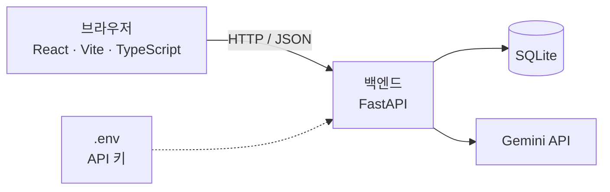

# API-SPEC: 에러 해결 일기 (v1)

## 1. 문서 설명
- 전체 구조, API 목록, 요청·응답 형식, 담당자를 담는 문서다. 기능 설명은 PRD에 있으므로 여기서는 R-ID로만 가리킨다.
- **이번 버전(v1)의 범위는 "뼈대"다.** 프론트(React)와 백엔드(FastAPI)가 연결되는지 확인하는 데 필요한 내용까지만 다룬다.
  - 상세를 적는 API: 연결 확인 API(A-001) 하나
  - 기능 API: 목록에 "후보"로 자리만 잡는다
- 이번 버전에서 다루지 않는 것:
  - 기능 API의 요청·응답 필드 (Q-001 ~ Q-004, DATA-MODEL 결정 후)
  - 테이블 구조 (DATA-MODEL)
  - Gemini 프롬프트와 응답 JSON 형식 (PROMPTS)
  - 배포 설정

## 2. 전체 구조



- 프론트는 백엔드 API만 호출한다. **프론트는 Gemini를 직접 호출하지 않는다.**
- Gemini API는 백엔드에서만 호출한다. API 키는 백엔드 `.env`에만 둔다. (CLAUDE.md 6절)
- 기술 스택: FastAPI + React(Vite, TypeScript) + SQLite + Gemini API (D-001)

## 3. 공통 규칙

**확정**
- 요청·응답 본문은 JSON을 쓴다.
- 로그인이 없으므로 인증 헤더를 쓰지 않는다. (D-002)
- 기본 경로(prefix)는 `/api`다. 모든 라우터에 붙인다.
- 성공 응답은 데이터를 그대로 반환한다. (감싸지 않음)

**[결정 필요]**

| 항목 | 선택지 | 장점 | 단점 |
|------|--------|------|------|
| 에러 응답 형식 | ① FastAPI 기본 `{ "detail": ... }` | 추가 코드가 필요 없다 | 입력 검증 에러(422)는 `detail`이 배열이라 모양이 다르다 |
| | ② `{ "error": { "code": ..., "message": ... } }` | 프론트에서 한 가지 방식으로 처리할 수 있다 | 예외 핸들러를 직접 만들어야 한다 |
| 날짜 형식 | ① ISO 8601 UTC (`2026-10-30T06:00:00Z`) | 표준적이고 시간대 혼동이 없다 | 화면에서 한국 시간으로 바꿔야 한다 |
| | ② ISO 8601 한국 시간 (`2026-10-30T15:00:00+09:00`) | 화면에 바로 쓰기 쉽다 | 서버에서 시간대를 지정해야 한다 |
| | ③ Unix 시간(초) | 계산이 쉽다 | 사람이 읽기 어렵다 |
| JSON 필드 이름 | ① snake_case (`created_at`) | 파이썬 코드를 그대로 쓴다 | TypeScript 관례와 다르다 |
| | ② camelCase (`createdAt`) | TypeScript 관례에 맞다 | FastAPI에 별칭(alias) 설정이 필요하다 |
| URL 이름 | ① 복수 명사 + kebab-case (`/errors`, `/ai-suggestions`) | 흔히 쓰는 방식이라 읽기 쉽다 | - |
| | ② 다른 규칙 | 팀이 정한 방식을 따른다 | 5절 후보 경로를 바꿔야 한다 |

## 4. 개발 환경 연결 방식

**확정**
- 프론트는 Vite 개발 서버 프록시로 백엔드를 호출한다. `/api`로 시작하는 요청을 백엔드로 전달한다.
- 그래서 백엔드에는 CORS 설정을 넣지 않는다.
- 백엔드 포트는 8000이다. (uvicorn 기본값)
- FastAPI 자동 문서는 `http://localhost:8000/docs`에서 직접 연다. (`/api` 밖이라 프록시를 거치지 않음)

**[결정 필요]**

| 항목 | 선택지 | 장점 | 단점 |
|------|--------|------|------|
| 프론트 포트 | ① Vite 기본값 5173 | 별도 설정이 필요 없다 | 다른 프로젝트와 같이 실행하면 충돌할 수 있다 |
| | ② 직접 지정 | 충돌을 피할 수 있다 | 두 사람이 같은 설정을 맞춰야 한다 |

- 실행 명령은 README에서 정한다. [결정 필요]

## 5. API 목록

경로는 prefix를 뺀 상대 경로다. **A-002 ~ A-009는 후보이며 확정이 아니다.**

| ID | 이름 | 메서드 | 경로 | 관련 R-ID | 담당 | 상태 |
|----|------|--------|------|-----------|------|------|
| A-001 | 연결 확인 | GET | `/health` (전체: `/api/health`) | - | 공용 | 구현됨 |
| A-002 | 에러 등록 | POST | `/errors` | R-001 | 팀원 1 | 후보 (Q-001 결정 후 작성) |
| A-003 | 기존 기록 검색 | GET 또는 POST | `/errors/search` | R-002 | 팀원 1 | 후보 (Q-002 결정 후 작성) |
| A-004 | 태그·시리즈 목록 | GET | `/tags`, `/series` | R-001 (PRD 6절 규칙) | 팀원 1 | 후보 (Q-005 결정 후 작성) |
| A-005 | AI 해결책 제안 | POST | `/errors/{id}/ai-suggestions` | R-003 | 팀원 2 | 후보 (Q-003 결정 후 작성) |
| A-006 | 시도 기록 | POST | `/errors/{id}/attempts` | R-004 | 팀원 2 | 후보 (DATA-MODEL 결정 후 작성) |
| A-007 | 해결 처리 | PATCH 또는 POST | `/errors/{id}` 또는 `/errors/{id}/resolve` | R-004 | 팀원 2 | 후보 (DATA-MODEL 결정 후 작성) |
| A-008 | 내 기록 목록 | GET | `/errors` | R-005 | 팀원 1 | 후보 (Q-004 결정 후 작성) |
| A-009 | 에러 일기 상세 | GET | `/errors/{id}` | R-004, R-005 | [결정 필요] | 후보 (S-003과 함께 작성) |

- 기능 API의 요청·응답 필드는 해당 Q-ID와 DATA-MODEL이 결정된 뒤 작성한다.
- 담당은 CLAUDE.md 5절을 따른다. A-009는 기능 영역("에러 일기 상세")으로 보면 팀원 2, R-005 기준으로 보면 팀원 1이라 [결정 필요]다.
- 라우터 파일은 경로가 아니라 담당 기준으로 나눈다. `/errors` 경로를 두 사람이 함께 쓰지만, 각자 자기 파일에만 추가한다.

| 담당 | 라우터 파일 | API |
|------|-------------|-----|
| 공용 | `backend/app/routers/health.py` | A-001 |
| 팀원 1 | `backend/app/routers/records.py` | A-002, A-003, A-004, A-008 |
| 팀원 2 | `backend/app/routers/solve.py` | A-005, A-006, A-007 |

- `main.py`는 `records`를 `solve`보다 먼저 등록한다. 고정 경로(`/errors/search`)가 변수 경로(`/errors/{id}`)보다 먼저 매칭되게 하기 위해서다.

## 6. API 상세

### A-001 연결 확인
| 항목 | 내용 |
|------|------|
| 목적 | 서버가 살아 있는지만 응답한다 |
| 메서드 | GET |
| 경로 | `/api/health` |
| 요청 | 본문 없음, 인증 헤더 없음 |
| 처리 | DB와 Gemini를 호출하지 않는다 |
| 담당 | 공용 (`backend/app/routers/health.py`) |

**응답 예시 (200)**
```json
{ "status": "ok" }
```

## 7. 완료 기준
- [ ] 두 사람 컴퓨터에서 백엔드와 프론트가 각각 실행된다 (실행 명령은 README, [결정 필요])
- [x] 브라우저에서 A-001을 직접 호출하면 응답 예시와 같은 응답이 온다 (2026-10-30 백엔드 확인)
- [ ] 프론트에서 A-001을 호출해 응답을 받는다
- [ ] 프론트 코드에 Gemini API 키와 Gemini 직접 호출이 없다
- [x] 백엔드에 `.env.example`이 있고, `.env`는 `.gitignore`로 커밋에서 제외된다

## 8. 변경 이력

| 버전 | 날짜 | 내용 |
|------|------|------|
| v1 | 2026-10-30 | 뼈대 범위 최초 작성 (전체 구조, 공통 규칙, 연결 방식, A-001 상세, 기능 API 후보 목록) |
| v1 | 2026-10-30 | 백엔드 뼈대 구현 반영: prefix `/api`, 성공 응답 감싸지 않음, Vite 프록시·CORS 없음, 백엔드 포트 8000, A-001 `/api/health` 구현됨, 라우터 파일 담당 |
