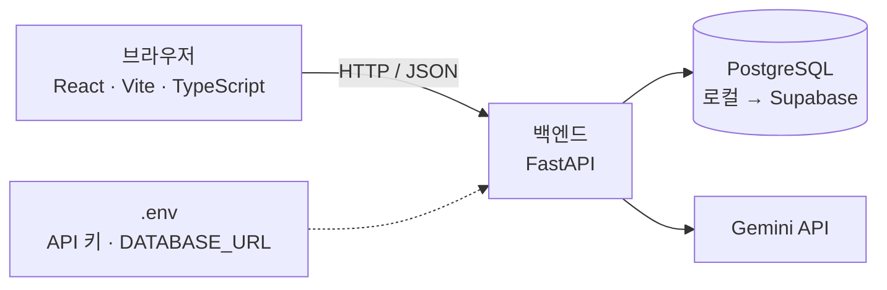

# API-SPEC: 에러 해결 일기 (v10)

## 1. 문서 설명
- 전체 구조, API 목록, 요청·응답 형식, 담당자를 담는 문서다. 기능 설명은 PRD에 있으므로 여기서는 R-ID로만 가리킨다.
- **v10은 v9에서 A-002를 "기록 저장"(에러와 시도를 한 번에 저장, `attempts` 필수)으로 확장하고, A-007(한 줄 정리 수정)을 후보에서 확정으로 바꾸며, A-009·A-010 응답에 `ai_feedback`을 더하고, A-016(AI 피드백)을 추가한 것이다(D-065 ~ D-070). A-006은 그대로 두지만 에러 해결 화면은 더 이상 부르지 않는다.**
- **v9는 v8에 A-015(시리즈 새로 만들기, `POST /api/series`)를 더한 것이다(D-061). 나머지 API는 바뀌지 않는다.**
- **v8은 v7의 API를 그대로 두고 DB를 PostgreSQL로 바꾼 것이다(지금은 로컬, 이후 Supabase. 2절, D-057, D-058).**
- **v7의 범위는 v6에 "내 기록 정리"(기록 수정·삭제, 태그·시리즈 관리, 시리즈 안 순서)를 더한 것이다.** A-010 ~ A-014는 새 API다. A-010 ~ A-014와 A-004의 `error_count`, A-008·A-009의 `series_id`·`series_order`는 모두 구현됨이다.
  - 상세를 적는 API: A-001 ~ A-016
- 이번 버전에서 다루지 않는 것:
  - 기능 API의 요청·응답 필드 (Q-001 ~ Q-004, DATA-MODEL 결정 후)
  - 테이블 구조 (DATA-MODEL_N.md)
  - Gemini 프롬프트와 응답 JSON 형식 (PROMPTS)
  - 배포 설정

## 2. 전체 구조



- 프론트는 백엔드 API만 호출한다. **프론트는 Gemini를 직접 호출하지 않는다.**
- Gemini API는 백엔드에서만 호출한다. API 키는 백엔드 `.env`에만 둔다. (CLAUDE.md 6절)
- 기술 스택: FastAPI + React(Vite, TypeScript) + PostgreSQL(로컬, 이후 Supabase) + Gemini API (D-001, D-057, D-058)

## 3. 공통 규칙

**확정**
- 요청·응답 본문은 JSON을 쓴다.
- 로그인이 없으므로 인증 헤더를 쓰지 않는다. (D-002)
- 기본 경로(prefix)는 `/api`다. 모든 라우터에 붙인다.
- 성공 응답은 데이터를 그대로 반환한다. (감싸지 않음)
- 날짜·시간은 ISO 8601 한국 시간(`2026-11-02T15:00:00+09:00`)으로 응답한다. (D-015)

**[결정 필요]**

| 항목 | 선택지 | 장점 | 단점 |
|------|--------|------|------|
| 에러 응답 형식 | ① FastAPI 기본 `{ "detail": ... }` | 추가 코드가 필요 없다 | 입력 검증 에러(422)는 `detail`이 배열이라 모양이 다르다 |
| | ② `{ "error": { "code": ..., "message": ... } }` | 프론트에서 한 가지 방식으로 처리할 수 있다 | 예외 핸들러를 직접 만들어야 한다 |
| JSON 필드 이름 | ① snake_case (`created_at`) | 파이썬 코드를 그대로 쓴다 | TypeScript 관례와 다르다 |
| | ② camelCase (`createdAt`) | TypeScript 관례에 맞다 | FastAPI에 별칭(alias) 설정이 필요하다 |
| URL 이름 | ① 복수 명사 + kebab-case (`/errors`, `/ai-suggestions`) | 흔히 쓰는 방식이라 읽기 쉽다 | - |
| | ② 다른 규칙 | 팀이 정한 방식을 따른다 | 5절 후보 경로를 바꿔야 한다 |

## 4. 개발 환경 연결 방식

**확정**
- 프론트는 Vite 개발 서버 프록시로 백엔드를 호출한다. `/api`로 시작하는 요청을 백엔드로 전달한다. (`frontend/vite.config.ts`의 `server.proxy`)
- 그래서 백엔드에는 CORS 설정을 넣지 않는다.
- 백엔드 포트는 8000이다. (uvicorn 기본값)
- FastAPI 자동 문서는 `http://localhost:8000/docs`에서 직접 연다. (`/api` 밖이라 프록시를 거치지 않음)

**[결정 필요]**

| 항목 | 선택지 | 장점 | 단점 |
|------|--------|------|------|
| 프론트 포트 | ① Vite 기본값 5173 | 별도 설정이 필요 없다 | 다른 프로젝트와 같이 실행하면 충돌할 수 있다 |
| | ② 직접 지정 | 충돌을 피할 수 있다 | 두 사람이 같은 설정을 맞춰야 한다 |

- 실행 명령은 README에서 정한다. [결정 필요]

## 5. API 목록

경로는 prefix를 뺀 상대 경로다.

| ID | 이름 | 메서드 | 경로 | 관련 R-ID | 담당 | 상태 |
|----|------|--------|------|-----------|------|------|
| A-001 | 연결 확인 | GET | `/health` (전체: `/api/health`) | - | 공용 | 구현됨 |
| A-002 | 기록 저장 (에러 등록) | POST | `/errors` | R-001 | 팀원 1 | 구현됨 (6절). `attempts`를 필수로 확장해 에러·시도·해결 처리를 한 트랜잭션으로 저장 (D-065) |
| A-003 | 기존 기록 검색 | POST | `/errors/search` (전체: `/api/errors/search`) | R-002 | 팀원 1 | 구현됨 (6절, D-040) |
| A-004 | 태그·시리즈 목록 | GET | `/tags`, `/series` (전체: `/api/tags`, `/api/series`) | R-001 (PRD 6절 규칙) | 팀원 1 | `/series`, `/tags` 구현됨. 항목에 `error_count` 포함 (D-050, 6절) |
| A-005 | AI 해결책 제안 | POST | `/ai-suggestions` (전체: `/api/ai-suggestions`) | R-003 | 팀원 2 | 구현됨 (저장 없음, D-027, `previous_attempts` 포함) |
| A-006 | 시도 기록 | POST | `/errors/{id}/attempts` (전체: `/api/errors/{id}/attempts`) | R-004 | 팀원 2 | 구현됨 (6절) |
| A-007 | 한 줄 정리 수정 | PATCH | `/errors/{id}/summary` (전체: `/api/errors/{id}/summary`) | R-004 | 팀원 2 | 구현됨 (6절, D-047, D-070) |
| A-008 | 내 기록 목록 | GET | `/errors` (전체: `/api/errors`) | R-005 | 팀원 1 | 구현됨 (6절, D-035, D-036). `series_id` 쿼리·`series_order` 필드 포함 (D-042, D-051) |
| A-009 | 에러 일기 상세 | GET | `/errors/{id}` (전체: `/api/errors/{id}`) | R-004, R-005 | 팀원 1 (D-031) | 구현됨 (6절). `series_order` 필드 포함 |
| A-010 | 기록 수정 | PATCH | `/errors/{id}` (전체: `/api/errors/{id}`) | R-005 | 팀원 1 | 구현됨 (6절, D-047, D-048) |
| A-011 | 기록 삭제 | DELETE | `/errors/{id}` (전체: `/api/errors/{id}`) | R-005 | 팀원 1 | 구현됨 (6절, D-043 ~ D-045) |
| A-012 | 태그 이름 변경·삭제 | PATCH, DELETE | `/tags/{id}` (전체: `/api/tags/{id}`) | R-005 | 팀원 1 | 구현됨 (6절, D-049, D-050) |
| A-013 | 시리즈 이름·설명 변경·삭제 | PATCH, DELETE | `/series/{id}` (전체: `/api/series/{id}`) | R-005 | 팀원 1 | 구현됨 (6절, D-049, D-050, D-054) |
| A-014 | 시리즈 안 순서 바꾸기 | PUT | `/series/{id}/order` (전체: `/api/series/{id}/order`) | R-005 | 팀원 1 | 구현됨 (6절, D-051) |
| A-015 | 시리즈 새로 만들기 | POST | `/series` (전체: `/api/series`) | R-005 | 팀원 1 | 구현됨 (6절, D-061) |
| A-016 | AI 피드백 | POST | `/errors/{id}/feedback` (전체: `/api/errors/{id}/feedback`) | R-004 | 팀원 2 | 구현됨 (6절, Q-003, D-068, 프롬프트 PROMPTS P-002) |

- 기능 API의 요청·응답 필드는 해당 Q-ID와 DATA-MODEL이 결정된 뒤 작성한다.
- A-002를 부르는 곳은 에러 해결 화면뿐이라 `attempts`를 필수로 바꿔도 다른 화면은 깨지지 않는다. (D-065)
- 시리즈를 새로 만드는 API는 A-015(`POST /series`)뿐이다. (D-061) 새 시리즈는 에러 저장(A-002)·수정(A-010) 때도 함께 만들 수 있다. (D-011) 태그를 새로 만드는 API(예: `POST /tags`)는 두지 않는다. 새 태그는 에러 저장(A-002) 때 함께 만든다. (D-020) 수정·삭제는 A-012, A-013이 한다.
- 담당은 CLAUDE.md 5절을 따른다. A-009는 팀원 1이 맡는다. (D-031)
- A-006의 해결 처리는 팀원 1의 `repositories/errors.py`에 있는 `mark_resolved()`를 부른다. 이 함수는 팀원 2가 추가한다. (D-030)
- A-008·A-009의 시도 횟수·시도 목록은 팀원 2의 `repositories/attempts.py`에 팀원 1이 추가한 읽기 함수로 가져온다. (D-038)
- A-011의 시도 삭제 SQL도 `repositories/attempts.py`에 팀원 1이 추가한다. 추가하면 완료 보고에 표시한다. (D-045)
- A-010의 태그·시리즈 규칙은 A-002와 같은 함수를 재사용한다. (D-048)
- 라우터 파일은 경로가 아니라 담당 기준으로 나눈다. `/errors` 경로를 두 사람이 함께 쓰지만, 각자 자기 파일에만 추가한다.

| 담당 | 라우터 파일 | API |
|------|-------------|-----|
| 공용 | `backend/app/routers/health.py` | A-001 |
| 팀원 1 | `backend/app/routers/records.py` | A-002(구현됨), A-003(구현됨), A-004(`/series`, `/tags` 구현됨), A-008(구현됨), A-009(구현됨), A-010 ~ A-015(구현됨) |
| 팀원 2 | `backend/app/routers/solve.py` | A-005(구현됨), A-006(구현됨), A-007(구현됨), A-016(구현됨) |

- `main.py`는 `records`를 `solve`보다 먼저 등록한다. 고정 경로(`/errors/search`)가 변수 경로(`/errors/{id}`)보다 먼저 매칭되게 하기 위해서다.
- 같은 이유로 `records.py` 안에서도 A-003(`/errors/search`)은 A-009(`/errors/{id}`)보다 **위에** 선언한다. `GET /errors/{id}`와 `POST /errors/{id}/attempts`는 메서드·경로가 달라 충돌하지 않는다.

## 6. API 상세

### A-001 연결 확인
| 항목 | 내용 |
|------|------|
| 목적 | 서버가 살아 있는지만 응답한다 |
| 메서드 | GET |
| 경로 | `/api/health` |
| 요청 | 본문 없음, 인증 헤더 없음 |
| 처리 | DB와 Gemini를 호출하지 않는다 |
| 담당 | 공용 (`backend/app/routers/health.py`) |

**응답 예시 (200)**
```json
{ "status": "ok" }
```

### A-002 기록 저장 (에러 등록)
| 항목 | 내용 |
|------|------|
| 목적 | 에러와 화면에 모아 둔 시도를 한 번에 저장한다 (R-001, D-024, D-065). 이름은 "에러 등록"에서 "기록 저장"으로 바뀌었다 |
| 메서드·경로 | `POST /api/errors` |
| 호출 시점 | 에러 해결 화면의 "기록 저장" 때, 그리고 비슷한 기록의 "이 방법 적용" 때 (D-065, D-069). "해당 없음 → AI에게 묻기"를 누를 때는 부르지 않는다 (이전에는 이때 미해결로 저장했다, D-025) |
| 처리 | 모든 검사를 먼저 하고, 통과하면 새 시리즈 → 새 태그 → 에러 → `error_tags` → 시도 → (마지막 시도가 해결됨이면) 해결 처리 순서로 한 트랜잭션에 저장한다. 검사에 실패하면 아무것도 저장되지 않는다 |
| 담당 | 팀원 1 (라우터 `backend/app/routers/records.py`, SQL `backend/app/repositories/errors.py`·`series.py`·`tags.py`, 시도 저장은 팀원 2 파일 `attempts.py`의 기존 `create_attempt()`를 그대로 씀 D-071, 해결 처리는 `mark_resolved()` D-030) |

**요청 필드**
| 필드 | 타입 | 필수 | 설명 |
|------|------|------|------|
| `error_message` | 문자열 | 필수 | 에러 메시지. 앞뒤 공백을 빼고 저장한다. 비면 422. 최대 10,000자(A-005와 같은 상한, 넘으면 422) |
| `situation` | 문자열 / null | 선택 | 상황. 앞뒤 공백을 빼고, 비면 null로 저장한다 |
| `series_id` | 정수 / null | 선택 | 기존 시리즈 ID. 없는 ID면 422 |
| `new_series_name` | 문자열 / null | 선택 | 새 시리즈 이름. 기존 시리즈와 같으면(공백 제외·대소문자 무시) 기존 시리즈를 쓴다 (D-017, D-033). 공백뿐이면 422 |
| `tag_ids` | 정수 배열 | 선택 | 기존 태그 ID. 없는 ID가 있으면 422 |
| `new_tag_names` | 문자열 배열 | 선택 | 새 태그 이름. 정규화(D-019)한 뒤 빈 값은 버리고, 기존 태그와 같으면 기존 태그로 합친다 |
| `attempts` | 배열 | **필수 (1개 이상)** | 화면에 모아 둔 시도. 순서대로 `seq` 1부터 저장한다. 항목은 `action`(문자열, 앞뒤 공백을 빼고 비면 422), `result`(`solved`/`failed`/`partial`, 그 밖의 값은 422, D-028). 없거나 비면 422 "시도 기록이 1개 이상 있어야 저장할 수 있어요." |
| `summary` | 문자열 / null | 선택 | 내 한 줄 정리. 앞뒤 공백을 빼고, 비면 null. **마지막 시도가 `solved`이면 필수**(비면 422 "해결됨으로 저장하려면 한 줄 정리를 입력해 주세요.", A-006과 같은 문구, D-026). 그 밖에는 선택이고 있으면 미해결 에러에도 저장한다 (D-067) |

- `series_id`와 `new_series_name`은 둘 중 하나만 보낸다. 둘 다 보내면 422, 둘 다 없으면 시리즈 없음.
- 태그는 `tag_ids`와 `new_tag_names`를 합쳐 중복을 뺀 뒤 5개를 넘으면 422 (D-022).
- `solved`는 **마지막 시도에만** 올 수 있다. 앞 시도가 `solved`이면 422 "해결됨은 마지막 시도에만 쓸 수 있어요.".
- 에러 상태: 마지막 시도가 `solved`이면 `resolved`(`summary`·`resolved_at` 저장), 아니면 `unresolved`다 (D-028, D-029, D-066).
- 시리즈에 넣으면 그 에러의 `series_order`는 그 시리즈의 마지막 순서 + 1이다 (D-051). `errors.create_error()` 안에서 매기므로 "이 방법 적용"(D-069)도 같다. 응답에는 넣지 않는다.

**요청 예시**
```json
{
  "error_message": "ModuleNotFoundError: No module named 'google.generativeai'",
  "situation": "새로 만든 가상환경에서 처음 실행함",
  "series_id": null,
  "new_series_name": "개발 환경",
  "tag_ids": [1],
  "new_tag_names": ["가상환경"],
  "attempts": [
    { "action": "pip install google-generativeai 재설치", "result": "failed" },
    { "action": "가상환경 다시 활성화 후 설치", "result": "solved" }
  ],
  "summary": "가상환경이 꺼진 터미널에서 설치해서 못 찾았다. 활성화한 뒤 설치해서 해결했다"
}
```

**응답 예시 (201)**
```json
{
  "id": 12,
  "error_message": "ModuleNotFoundError: No module named 'google.generativeai'",
  "situation": "새로 만든 가상환경에서 처음 실행함",
  "status": "resolved",
  "summary": "가상환경이 꺼진 터미널에서 설치해서 못 찾았다. 활성화한 뒤 설치해서 해결했다",
  "resolved_at": "2026-11-02T15:30:00+09:00",
  "series": { "id": 3, "name": "개발 환경" },
  "tags": [{ "id": 1, "name": "Python" }, { "id": 4, "name": "가상환경" }],
  "attempts": [
    { "seq": 1, "action": "pip install google-generativeai 재설치", "result": "failed", "created_at": "2026-11-02T15:30:00+09:00" },
    { "seq": 2, "action": "가상환경 다시 활성화 후 설치", "result": "solved", "created_at": "2026-11-02T15:30:00+09:00" }
  ],
  "created_at": "2026-11-02T15:30:00+09:00"
}
```

- `id`는 이후 A-016(`/api/errors/{id}/feedback`)과 상세(S-003, `/records/{id}`)에 쓴다.
- 미해결로 저장되면 `resolved_at`은 null이고 `summary`는 보낸 값(없으면 null)이다.
- 이전 버전(`attempts` 없이 미해결로 먼저 저장)과 호환되지 않는다. 기존 DB의 시도 없는 기록은 그대로 읽힌다.

### A-003 기존 기록 검색
| 항목 | 내용 |
|------|------|
| 목적 | 입력한 에러 메시지와 비슷한 해결된 기록을 유사도 높은 순으로 돌려준다 (R-002, D-040) |
| 메서드·경로 | `POST /api/errors/search` (에러 메시지가 최대 1만 자라 GET 쿼리 대신 본문으로 받는다) |
| 호출 시점 | 에러 메시지 입력이 멈추고 300ms 뒤 자동으로 (D-064). 에러를 저장하기 전이며, 이 API는 아무것도 저장하거나 바꾸지 않는다 |
| 요청 | JSON 본문 `error_message` (문자열, 최대 10,000자). 공백뿐이면 422, 넘으면 422. 인증 헤더 없음 |
| 처리 | `resolved` 상태인 기록만 비교한다. 두 메시지의 공백 모양과 대소문자를 무시하고 `difflib.SequenceMatcher`의 비율을 0~100%(반올림)로 바꾼다. 60% 이상만 돌려준다 |
| 정렬 | 유사도 내림차순. 같으면 `id`가 큰(최근) 기록이 먼저. 개수 제한은 없다 (화면에서 위 2건만 보이고 나머지는 스크롤, SCREEN-SPEC_5) |
| 담당 | 팀원 1 (라우터 `backend/app/routers/records.py`, SQL `backend/app/repositories/errors.py`의 `list_resolved_errors()`·`get_tags_by_error_ids()`, 시도 수는 `repositories/attempts.py`의 `count_by_error_ids()`, D-038) |

**요청 예시**
```json
{ "error_message": "ModuleNotFoundError: No module named 'google.generativeai'" }
```

**응답 예시 (200)**
```json
[
  {
    "id": 3,
    "error_message": "ModuleNotFoundError: No module named 'google.generativeai'",
    "similarity": 100,
    "summary": "패키지가 다른 가상환경에 설치돼 있었음. which python으로 환경 확인 후 프로젝트 환경 활성화",
    "attempt_count": 2,
    "tags": [{ "id": 1, "name": "Python" }, { "id": 4, "name": "가상환경" }],
    "resolved_at": "2026-11-02T15:40:00+09:00"
  }
]
```

**응답 필드** (배열의 각 항목)
| 필드 | 타입 | 설명 |
|------|------|------|
| `id` | 정수 | 비슷한 기록의 에러 ID |
| `error_message` | 문자열 | 그 기록의 에러 메시지 (화면은 첫 줄만 제목으로 쓴다) |
| `similarity` | 정수 | 유사도(%), 60~100 |
| `summary` | 문자열 | 내 한 줄 정리 = 해결법 |
| `attempt_count` | 정수 | 그 기록의 시도 수 ("시도 N회 만에 해결") |
| `tags` | 배열 | 붙은 태그 (`id`, `name`, 이름순) |
| `resolved_at` | 문자열 | 해결 시각. ISO 8601 한국 시간 (D-015) |

- 비슷한 기록이 없으면 빈 배열 `[]`을 돌려준다. 프론트는 0건이면 영역을 숨긴다 (SCREEN-SPEC_8 화면 흐름).
- 유사도는 글자 단위 비교라서, 앞부분이 같은 메시지(예: `ModuleNotFoundError: No module named …`)끼리는 뒷부분이 달라도 60%를 넘을 수 있다. Traceback 전체와 한 줄 메시지처럼 길이가 크게 다를 때의 보정은 Later (PRD Q-002).
- "같은 에러예요, 이 방법 적용"은 전용 API 없이 A-002 한 번(시도 1개 `solved`, `summary`는 고른 기록의 `summary`)으로 처리한다 (D-069. 이전에는 A-002 → A-006, D-041).
- `POST /errors/search`는 `GET /errors/{id}`(A-009)와 메서드가 달라 충돌하지 않지만, 위 순서 규칙대로 A-009보다 위에 선언했다.
- 422의 응답 본문은 A-002와 같다.

### A-004 시리즈 목록 (`GET /series`)
| 항목 | 내용 |
|------|------|
| 목적 | 에러 해결 화면에서 고를 수 있는 기존 시리즈 목록을 돌려준다 (R-001, D-006) |
| 메서드 | GET |
| 경로 | `/api/series` |
| 요청 | 본문·쿼리 없음, 인증 헤더 없음 |
| 처리 | `series` 테이블 전체를 `created_at` 내림차순(최근 만든 순)으로 돌려준다. `created_at`이 같으면 `id`가 큰 것이 먼저다. 테이블 구조는 DATA-MODEL_N.md |
| 담당 | 팀원 1 (라우터 `backend/app/routers/records.py`, SQL `backend/app/repositories/series.py`, D-016) |

**응답 예시 (200)**
```json
[
  { "id": 2, "name": "Gemini API 연동", "description": "Gemini 호출하며 만난 에러", "error_count": 3, "created_at": "2026-11-02T15:30:00+09:00" },
  { "id": 1, "name": "개발 환경", "description": null, "error_count": 0, "created_at": "2026-11-01T10:00:00+09:00" }
]
```

**응답 필드** (배열의 각 항목)
| 필드 | 타입 | 설명 |
|------|------|------|
| `id` | 정수 | 시리즈 ID |
| `name` | 문자열 | 시리즈 이름 (중복 없음) |
| `description` | 문자열 / null | 시리즈 설명. 없으면 null |
| `error_count` | 정수 | 이 시리즈에 속한 에러 수 (v7 추가). 시리즈 카드 "에러 3개"와 삭제 확인 창 "N개 기록에서 빠져요"에 쓴다 (D-050) |
| `created_at` | 문자열 | 만든 시각. ISO 8601 한국 시간 (D-015) |

- `error_count`는 필드 추가일 뿐이라 `SeriesSelect`는 그대로 동작한다. 개수도 시리즈마다 따로 세지 않고 한 번에 모아서 가져온다.
- 시리즈가 하나도 없으면 빈 배열 `[]`을 돌려준다.
- 성공 응답은 감싸지 않은 배열이다 (3절). 필드 이름은 A-005와 같이 snake_case를 쓴다 (3절 [결정 필요]는 그대로).
- DB 오류 시 응답 형식은 3절 "에러 응답 형식" [결정 필요]를 따른다.

### A-004 태그 목록 (`GET /tags`)
| 항목 | 내용 |
|------|------|
| 목적 | 에러 해결 화면의 태그 자동 완성에 쓸 기존 태그 전체 목록을 돌려준다 (R-001, D-006, D-021) |
| 메서드 | GET |
| 경로 | `/api/tags` |
| 요청 | 본문·쿼리 없음, 인증 헤더 없음. 검색어로 거르지 않고 전체를 준다 (거르는 것은 프론트, D-021) |
| 처리 | `tags` 테이블 전체를 `name_key` 오름차순(이름순, 대소문자 무시)으로 돌려준다. `name_key`가 같을 수는 없지만 정렬을 고정하려고 `id` 오름차순을 덧붙인다. 테이블 구조는 DATA-MODEL_N.md |
| 담당 | 팀원 1 (라우터 `backend/app/routers/records.py`, SQL `backend/app/repositories/tags.py`, D-016) |

**응답 예시 (200)**
```json
[
  { "id": 2, "name": "AI", "error_count": 2, "created_at": "2026-11-02T15:30:00+09:00" },
  { "id": 1, "name": "Python", "error_count": 5, "created_at": "2026-11-01T10:00:00+09:00" },
  { "id": 3, "name": "가상환경", "error_count": 0, "created_at": "2026-11-02T16:00:00+09:00" }
]
```

**응답 필드** (배열의 각 항목)
| 필드 | 타입 | 설명 |
|------|------|------|
| `id` | 정수 | 태그 ID |
| `name` | 문자열 | 보이는 이름. 처음 입력한 표기 그대로 (D-019) |
| `error_count` | 정수 | 이 태그가 붙은 에러 수 (v7 추가). 삭제 확인 창 "N개 기록에서 빠져요"에 쓴다 (D-050) |
| `created_at` | 문자열 | 만든 시각. ISO 8601 한국 시간 (D-015) |

- `error_count`는 필드 추가일 뿐이라 `TagInput`은 그대로 동작한다. (계획서 5절에는 `GET /series`만 있었으나, 태그 삭제 확인 창에도 개수가 필요해 태그에도 넣는다.)
- 비교용 `name_key`는 응답에 넣지 않는다. 프론트는 같은 규칙(DATA-MODEL tags 정규화 규칙)으로 직접 비교한다.
- 태그가 하나도 없으면 빈 배열 `[]`을 돌려준다.
- 정렬은 에러가 저장되기 시작하면 "많이 쓴 순"으로 바꾼다 (D-021, 그때 새 D-ID).
- 성공 응답·필드 이름·DB 오류 처리는 `GET /series`와 같다.

### A-005 AI 해결책 제안
| 항목 | 내용 |
|------|------|
| 목적 | 입력한 에러 메시지를 Gemini가 분석해 추정 원인과 해결 제안을 돌려준다 (R-003) |
| 메서드 | POST |
| 경로 | `/api/ai-suggestions` |
| 요청 | JSON 본문 `error_message` (문자열, 1~10,000자), `previous_attempts` (선택, 아래 참고). 인증 헤더 없음 |
| 호출 시점 | ① "해당 없음 → AI에게 묻기"를 누른 직후. 저장하지 않는다 (D-064, D-065) ② "해결 안 됨 → 다음 방법 제안받기"에서 이번 시도를 화면에 모은 직후, 지금까지의 시도를 `previous_attempts`로 붙여서 (D-027, D-065) |
| 처리 | Gemini를 백엔드에서만 호출한다. AI 제안은 DB에 저장하지 않는다 (D-027) |
| 실패 처리 | 아래 "실패 시" 참고. Gemini 쪽 문제로는 에러 응답을 내지 않고 항상 200 |
| 담당 | 팀원 2 (`backend/app/routers/solve.py`) |

**요청 예시**
```json
{ "error_message": "ModuleNotFoundError: No module named 'google.generativeai'" }
```

**요청 예시 (다음 방법 제안, `previous_attempts` 포함)**
```json
{
  "error_message": "ModuleNotFoundError: No module named 'google.generativeai'",
  "previous_attempts": [
    { "action": "pip install google-generativeai 재설치", "result": "failed" },
    { "action": "가상환경 다시 활성화", "result": "partial" }
  ]
}
```

**`previous_attempts` 필드** (선택, D-027)
| 필드 | 타입 | 설명 |
|------|------|------|
| `action` | 문자열 | 시도한 내용 |
| `result` | `"failed"` / `"partial"` | 결과 (D-028). 해결된 에러에는 다음 방법을 묻지 않으므로 `solved`는 오지 않는다 |

- 없거나 빈 배열이면 지금과 똑같이 동작한다 (하위 호환).
- 있으면 프롬프트에 "이미 실패한 방법은 다시 제안하지 않는다"를 더하고, 시도 내용은 `<error>`처럼 데이터로만 다룬다(그 안의 지시문은 따르지 않음). 프롬프트는 PROMPTS_2 P-001 v2에 기록했다.
- 항목의 `action`이 비었거나 `result`가 `failed`·`partial`이 아니면 422.
- 실패 처리(재시도, 대체 모델, unavailable 안내)는 아래 "실패 시"와 같다.

**응답 예시 (200, 성공)**
```json
{
  "status": "ok",
  "confidence": "높음",
  "cause": "패키지가 현재 파이썬 환경에 설치되어 있지 않다",
  "solutions": ["pip install google-generativeai 실행", "가상환경이 활성화됐는지 확인"],
  "message": null
}
```

**응답 필드**
| 필드 | 타입 | 설명 |
|------|------|------|
| `status` | `"ok"` 또는 `"unavailable"` | 분석 성공 여부 |
| `confidence` | `"높음"` / `"보통"` / `"낮음"` / null | 확신도. unavailable이면 null |
| `cause` | 문자열 / null | 추정 원인 |
| `solutions` | 문자열 배열 | 해결 제안(순서대로). unavailable이면 빈 배열 |
| `message` | 문자열 / null | unavailable일 때 화면에 보여줄 안내 문구 |

**실패 시**
- Gemini 시간 초과·실패 응답·JSON 형식 오류: `gemini-3.5-flash`를 최대 3회 → `gemini-3.5-flash-lite`를 최대 2회 시도한다. 모두 실패하면 200으로 `{ "status": "unavailable", "confidence": null, "cause": null, "solutions": [], "message": "지금은 AI 분석을 가져오지 못했어요. 잠시 뒤 다시 시도해 주세요." }`를 돌려준다.
- `GEMINI_API_KEY`가 비어 있어도 같은 unavailable 응답을 돌려준다.
- `error_message`가 비었거나 10,000자를 넘으면 422 (FastAPI 기본 검증 응답).
- 프론트는 네트워크 오류가 나도 같은 안내를 보여준다.

### A-006 시도 기록
| 항목 | 내용 |
|------|------|
| 목적 | 에러에 시도 하나를 저장한다. 결과가 "해결됨"이면 한 줄 정리와 해결 처리까지 함께 한다 (R-004, D-026) |
| 메서드 | POST |
| 경로 | `/api/errors/{id}/attempts` (`{id}`는 A-002가 돌려준 에러 ID, D-025) |
| 요청 | JSON 본문 `action`, `result`, `summary`(아래 표). 인증 헤더 없음 |
| 처리 | 아래 "처리 순서" |
| 담당 | 팀원 2 (라우터 `backend/app/routers/solve.py`, SQL `backend/app/repositories/attempts.py` + `repositories/errors.py`의 `mark_resolved()`, D-030) |

**요청 필드**
| 필드 | 타입 | 필수 | 설명 |
|------|------|------|------|
| `action` | 문자열 | 필수 | "무엇을 했나요". 앞뒤 공백을 뺀 값이 비면 422 |
| `result` | `"solved"` / `"failed"` / `"partial"` | 필수 | 결과 (D-028). 다른 값이면 422 |
| `summary` | 문자열 / null | `solved`일 때 필수 | 내 한 줄 정리. `solved`인데 비어 있으면 422. `solved`가 아니면 무시한다 |

**요청 예시 (해결됨)**
```json
{
  "action": "response_mime_type 설정 추가하고 다시 실행",
  "result": "solved",
  "summary": "AI가 JSON을 꾸며서 보내서 파싱이 안 됐고, 응답 형식을 설정으로 고정해서 해결했다"
}
```

**처리 순서** (한 트랜잭션)
1. 에러가 없으면 404.
2. 에러가 이미 `resolved`이면 409. 해결된 에러에는 시도를 추가하지 않는다 (D-032).
3. `seq` = 그 에러의 마지막 시도 번호 + 1 (첫 시도는 1). `(error_id, seq)` UNIQUE라 동시에 두 번 저장돼도 같은 번호가 생기지 않는다. 이때 늦은 쪽은 409 "같은 시도가 동시에 저장됐어요" (DATA-MODEL attempts).
4. 시도를 저장한다.
5. `result=solved`이면 같은 트랜잭션에서 에러의 `status=resolved`, `summary`, `resolved_at`을 바꾼다 (D-026, `mark_resolved()`).
6. `failed`·`partial`이면 에러는 `unresolved` 그대로 둔다 (D-029).

**응답 예시 (201)**
```json
{
  "attempt": { "id": 7, "error_id": 12, "seq": 1, "action": "response_mime_type 설정 추가하고 다시 실행", "result": "solved", "created_at": "2026-11-02T15:40:00+09:00" },
  "error": { "id": 12, "status": "resolved", "summary": "AI가 JSON을 꾸며서 보내서 파싱이 안 됐고, 응답 형식을 설정으로 고정해서 해결했다", "resolved_at": "2026-11-02T15:40:00+09:00" }
}
```

- `failed`·`partial`이면 `error.status`는 `unresolved`, `summary`·`resolved_at`은 null이다.
- 404·409·422의 응답 본문 형식은 3절 "에러 응답 형식" [결정 필요]를 따른다.
- 프론트는 "해결 안 됨 → 다음 방법 제안받기"에서 A-006이 성공한 뒤 A-005를 `previous_attempts`와 함께 부른다 (D-027). A-005가 실패해도 시도는 이미 저장된 상태다.

- A-006은 지우지 않는다. 에러 해결 화면은 더 이상 부르지 않고(D-065, 시도는 A-002에 함께 보낸다), 상세의 "시도 추가"(D-032, 이후 단계)용으로 남긴다.

### A-007 한 줄 정리 수정
| 항목 | 내용 |
|------|------|
| 목적 | 저장된 에러의 내 한 줄 정리를 고친다 (R-004, D-047, D-070). 결과 탭과 에러 일기 상세에서 쓴다 |
| 메서드·경로 | `PATCH /api/errors/{id}/summary` |
| 요청 | JSON 본문 `{ "summary": "문자열" }`. 앞뒤 공백을 뺀다 |
| 처리 | 해결된(`resolved`) 에러에 빈 값을 보내면 422 "해결된 기록은 한 줄 정리를 비울 수 없어요." 미해결 에러는 빈 값이면 null로 저장한다 (D-067). 상태는 바꾸지 않는다. 피드백은 여기서 다시 받지 않고, 화면이 저장 뒤 A-016을 따로 부른다 (D-068) |
| 응답 | 200 `{ "id": 12, "status": "resolved", "summary": "저장된 정리 또는 null" }` |
| 오류 | 없는 ID 404 `{ "detail": "에러 기록을 찾을 수 없어요." }` |
| 담당 | 팀원 2 (라우터 `backend/app/routers/solve.py`, SQL `repositories/errors.py`의 `set_summary()` D-072) |

### A-016 AI 피드백
| 항목 | 내용 |
|------|------|
| 목적 | 저장된 에러·시도·한 줄 정리를 보고 Gemini가 짧은 피드백(1~2문장, 잘한 점 + 빠진 점)을 만들어 `errors.ai_feedback`에 저장하고 돌려준다 (Q-003, D-068) |
| 메서드·경로 | `POST /api/errors/{id}/feedback` (요청 본문 없음) |
| 호출 시점 | 기록 저장 직후, 한 줄 정리를 고친 직후(덮어쓴다), 상세·결과 탭의 "피드백 받기"·"다시 받기" |
| 처리 | DB에 저장된 에러 메시지·시도 목록·한 줄 정리를 읽어 프롬프트(PROMPTS P-002)를 만든다. 한 줄 정리가 없으면 시도 기록만으로 피드백한다. A-005와 같은 모델·재시도·시간 초과 처리를 쓴다(`_generate_json()`). 성공하면 `ai_feedback`을 덮어쓴다 |
| 응답 | 200 `{ "status": "ok" \| "unavailable", "feedback": 문자열 \| null, "message": 문자열 \| null }`. 성공이면 `ok`와 `feedback`. Gemini 시간 초과·실패 응답·JSON 파싱 실패·키 없음이면 200 + `unavailable`(`feedback` null, `message`는 안내)이고 저장된 피드백은 바꾸지 않는다 (CLAUDE.md 6절) |
| 오류 | 없는 ID 404. 시도가 0개이고 한 줄 정리도 없으면 Gemini를 부르지 않고 422 "시도 기록이 없어 피드백을 받을 수 없어요." (이전 방식으로 저장돼 시도가 없는 기록이 있을 수 있다) |
| 담당 | 팀원 2 (라우터 `solve.py`, SQL `repositories/errors.py`의 `set_feedback()` D-072) |

- Gemini를 기다리는 동안 DB 트랜잭션을 열어 두지 않고(읽기 뒤 종료), 저장 직전에 에러를 다시 읽는다. 그사이 기록이 지워졌으면 404다.

### A-008 내 기록 목록
| 항목 | 내용 |
|------|------|
| 목적 | 내 기록 화면(S-002)에 저장된 에러 목록을 돌려준다. 상태·태그·검색어로 거른다 (R-005, D-035, D-036) |
| 메서드 | GET |
| 경로 | `/api/errors` |
| 요청 | 본문 없음. 쿼리 파라미터(아래, 모두 선택). 인증 헤더 없음 |
| 정렬 | `created_at` 내림차순(최근 등록 순), 같으면 `id` 내림차순. `series_id`가 있으면 `series_order` 오름차순, 같으면 `id` 오름차순 (D-051) |
| 담당 | 팀원 1 (라우터 `backend/app/routers/records.py`, SQL `repositories/errors.py`·`series.py`·`attempts.py`(D-038)) |

**쿼리 파라미터** (모두 선택)
| 이름 | 타입 | 설명 |
|------|------|------|
| `series_id` | 정수, 하나 | 그 시리즈의 에러만 (D-042). 있으면 시리즈 안 순서로 정렬한다. 없는 시리즈 ID면 422가 아니라 빈 결과 `[]` (`tag_id`와 같다). 다른 필터와 함께 쓰면 모두 만족하는 것만 준다 |
| `status` | `unresolved` / `resolved` | 없으면 전체. 다른 값이면 422 |
| `tag_id` | 정수, 여러 개 | `?tag_id=1&tag_id=3`. 고른 태그를 **모두** 가진 에러만. 같은 ID가 두 번 오면 한 번으로 본다. 없는 태그 ID면 422가 아니라 빈 결과 `[]` (필터 결과로 본다) |
| `q` | 문자열, 최대 200자 | 에러 메시지 부분 검색. 대소문자 무시. `%`·`_`도 글자 그대로 찾는다. 앞뒤 공백을 빼고 비면 무시. 200자를 넘으면 422 |

**응답 예시 (200)**
```json
[
  {
    "id": 12,
    "error_message": "json.decoder.JSONDecodeError: Expecting value: line 1 column 1 (char 0)",
    "status": "resolved",
    "series": { "id": 2, "name": "Gemini API 연동" },
    "series_order": 2,
    "tags": [{ "id": 2, "name": "AI" }, { "id": 1, "name": "Python" }],
    "attempt_count": 1,
    "created_at": "2026-10-28T14:05:00+09:00",
    "resolved_at": "2026-10-28T14:17:00+09:00"
  }
]
```

**응답 필드** (배열의 각 항목)
| 필드 | 타입 | 설명 |
|------|------|------|
| `id` | 정수 | 에러 ID. 상세(A-009, `/records/:id`)에 쓴다 |
| `error_message` | 문자열 | 에러 메시지 전체. 화면 제목은 첫 줄 |
| `status` | `"unresolved"` / `"resolved"` | 상태 (D-028) |
| `series` | `{ id, name }` / null | 시리즈 |
| `series_order` | 정수 / null | 시리즈 안 순서 (v7 추가). 시리즈가 없으면 null. 화면은 이 값이 아니라 목록 위치(1부터)를 순서 번호로 보여준다 (D-051) |
| `tags` | `{ id, name }` 배열 | 태그. 이름순(`name_key`) |
| `attempt_count` | 정수 | 저장한 시도 수 |
| `created_at` | 문자열 | 등록 시각. 화면은 이 날짜로 묶는다 |
| `resolved_at` | 문자열 / null | 해결 시각 |

- 결과가 없으면 빈 배열 `[]`이다.
- 목록의 시리즈·태그·시도 횟수는 에러마다 따로 조회하지 않고, 에러 ID 목록으로 한 번씩 모아서 가져온다 (N+1 조회 방지). 기록 수와 상관없이 쿼리는 4번(에러, 시리즈, 태그, 시도 수)이다.
- `q`는 여러 줄 메시지의 둘째 줄 이후도 검색한다 (메시지 전체 대상).
- 페이지 나누기는 하지 않는다 (1인 사용, D-002). 기록이 많아지면 그때 정한다.

### A-009 에러 일기 상세
| 항목 | 내용 |
|------|------|
| 목적 | 에러 일기 상세(S-003)에 에러 하나와 시도 목록, 한 줄 정리를 돌려준다 (R-004, R-005, D-031) |
| 메서드 | GET |
| 경로 | `/api/errors/{id}` |
| 요청 | 본문·쿼리 없음, 인증 헤더 없음 |
| 없으면 | 404 `{ "detail": "에러 기록을 찾을 수 없어요." }` |
| 담당 | 팀원 1 (라우터 `backend/app/routers/records.py`, SQL `repositories/errors.py`·`series.py`·`attempts.py`(D-038)) |

**응답 예시 (200)**
```json
{
  "id": 12,
  "error_message": "json.decoder.JSONDecodeError: Expecting value: line 1 column 1 (char 0)",
  "situation": null,
  "status": "resolved",
  "series": { "id": 2, "name": "Gemini API 연동" },
  "series_order": 2,
  "tags": [{ "id": 2, "name": "AI" }, { "id": 1, "name": "Python" }],
  "attempt_count": 1,
  "summary": "AI가 JSON을 꾸며서 보내서 파싱이 안 됐고, 응답 형식을 설정으로 고정해서 해결했다",
  "ai_feedback": "응답 형식을 설정으로 고정한 점이 좋아요. 다만 어떤 설정이 원인이었는지 정리에 적어 두면 다음에 더 빨리 찾을 수 있어요.",
  "attempts": [
    { "seq": 1, "action": "response_mime_type 설정 추가하고 다시 실행", "result": "solved", "created_at": "2026-10-28T14:17:00+09:00" }
  ],
  "created_at": "2026-10-28T14:05:00+09:00",
  "resolved_at": "2026-10-28T14:17:00+09:00"
}
```

- A-008 항목 필드에 `situation`, `summary`, `ai_feedback`, `attempts`를 더한 모양이다.
- `attempts`는 `seq` 오름차순이다. 항목은 `seq`, `action`, `result`(`solved`/`failed`/`partial`, D-028), `created_at`.
- 미해결이면 `resolved_at`은 null이다. `summary`는 저장했으면 값이 있고 없으면 null이다 (D-067).
- `ai_feedback`은 이전 기록이나 받기에 실패한 기록이면 null이다 (D-068). A-008 목록에는 넣지 않는다. A-010 응답도 같은 모양이라 함께 들어간다.
- `{id}`가 숫자가 아니면 422 (FastAPI 기본 검증).

### A-010 기록 수정
| 항목 | 내용 |
|------|------|
| 목적 | 저장된 에러의 상황·시리즈·태그를 고친다 (R-005, D-047, D-048) |
| 메서드·경로 | `PATCH /api/errors/{id}` |
| 요청 | JSON 본문. 모든 필드가 선택이고, **보낸 필드만** 바꾼다("안 보냄"과 `null`로 지움을 구분한다) |
| 처리 | 모든 검사를 먼저 하고, 통과하면 새 시리즈 → 새 태그 → 에러·`error_tags` 순서로 한 트랜잭션에 반영한다. 검사에 실패하면 아무것도 바뀌지 않는다 |
| 담당 | 팀원 1 (라우터 `records.py`, SQL `repositories/errors.py`·`series.py`·`tags.py`) |

**요청 필드**
| 필드 | 타입 | 설명 |
|------|------|------|
| `situation` | 문자열 / null | 보내면 상황을 바꾼다. 앞뒤 공백을 빼고 비거나 `null`이면 지운다(null 저장) |
| `series_id` | 정수 / null | 보내면 시리즈를 바꾼다. `null`이면 시리즈를 뗀다(`series_id`·`series_order` 모두 NULL). 없는 ID면 422 |
| `new_series_name` | 문자열 | 새 시리즈 이름. 기존 시리즈와 같으면(공백 제외·대소문자 무시) 기존 시리즈를 쓴다 (D-017, D-033). 공백뿐이면 422 |
| `tag_ids` | 정수 배열 | 기존 태그 ID. 없는 ID가 있으면 422 |
| `new_tag_names` | 문자열 배열 | 새 태그 이름. 정규화·기존 표기로 합침 (D-019) |

- 시리즈: `series_id`와 `new_series_name`을 둘 다 보내면 422 (A-002와 같다, D-048). 다른 시리즈로 바뀌면 새 시리즈의 마지막 순서가 된다. 같은 시리즈를 다시 보내면 순서는 그대로다 (D-051).
- 태그: `tag_ids`와 `new_tag_names` 중 **하나라도 보내면** 태그 전체를 이 값으로 바꾼다(기존 연결은 모두 지우고 새로 넣는다). 보낸 쪽이 없으면 빈 배열로 본다. 합쳐서 중복을 뺀 뒤 5개를 넘으면 422 (D-022). 빈 배열이면 태그를 모두 뗀다. 둘 다 안 보내면 태그는 그대로다.
- 에러 메시지는 받지 않는다(보내도 무시한다, D-047). 상태·한 줄 정리·시도도 바뀌지 않는다.
- 아무 필드도 보내지 않으면 아무것도 바꾸지 않고 현재 상세를 돌려준다.
- 화면은 손댄 항목만 보낸다. 안 건드린 시리즈·태그까지 보내면 그 사이 다른 곳에서 지운 항목 때문에 괜히 422가 날 수 있기 때문이다.

**요청 예시** (상황과 태그만 고침)
```json
{ "situation": "배포 서버에서도 같은 에러", "tag_ids": [1], "new_tag_names": ["배포"] }
```

**응답 (200)**: A-009 에러 일기 상세와 같은 모양(바뀐 값)이다.
- 404 `{ "detail": "에러 기록을 찾을 수 없어요." }`. 검증 실패는 422.

### A-011 기록 삭제
| 항목 | 내용 |
|------|------|
| 목적 | 에러 기록과 딸린 시도·태그 연결을 지운다. 되돌릴 수 없다 (R-005, D-043) |
| 메서드·경로 | `DELETE /api/errors/{id}` |
| 요청 | 본문 없음 |
| 처리 | 한 트랜잭션에서 `attempts` → `error_tags` → `errors` 순서로 지운다 (D-044). 중간에 실패하면 아무것도 지워지지 않는다. 쓰이지 않게 된 태그·시리즈는 남긴다 (D-046) |
| 담당 | 팀원 1 (라우터 `records.py`, SQL `repositories/errors.py`, 시도 삭제는 `repositories/attempts.py`(팀원 2 파일, D-045)) |

- 응답 204 (본문 없음). 없는 ID면 404 `{ "detail": "에러 기록을 찾을 수 없어요." }`. 이미 지워진 기록을 다시 지우려 해도 404다.

### A-012 태그 이름 변경·삭제
**`PATCH /api/tags/{id}`** — 이름 변경
| 항목 | 내용 |
|------|------|
| 요청 | JSON 본문 `{ "name": "새 이름" }` |
| 처리 | 이름을 정규화한다(D-019). 결과가 비면 422. 정규화한 `name_key`가 **다른** 태그에 이미 있으면 409 `{ "detail": "이미 있는 이름이에요." }` (D-049). 같은 태그의 대소문자만 바꾸는 것(`python` → `Python`)은 허용. `name`과 `name_key`를 함께 바꾼다 |
| 응답 | 200, 바뀐 태그 `{ id, name, error_count, created_at }` (A-004 태그 항목과 같다) |
| 오류 | 없는 ID 404 `{ "detail": "태그를 찾을 수 없어요." }` |

**`DELETE /api/tags/{id}`** — 삭제
| 항목 | 내용 |
|------|------|
| 처리 | 한 트랜잭션에서 `error_tags`(그 태그의 연결)를 지운 뒤 `tags`를 지운다. 쓰이는 태그도 지울 수 있고, 기록은 남는다 (D-050) |
| 응답 | 204. 없는 ID면 404 |

- 담당 팀원 1 (라우터 `records.py`, SQL `repositories/tags.py`). 확인 창의 "N개 기록에서 빠져요"는 목록의 `error_count`를 쓴다.

### A-013 시리즈 이름·설명 변경·삭제
**`PATCH /api/series/{id}`** — 이름·설명 변경 (D-054)
| 항목 | 내용 |
|------|------|
| 요청 | JSON 본문 `name`(문자열), `description`(문자열 / null). 모두 선택이고 보낸 필드만 바꾼다 |
| 처리 | `name`은 앞뒤 공백을 뺀다. 비면 422. 공백을 빼고 대소문자를 무시해 **다른** 시리즈와 같으면 409 `{ "detail": "이미 있는 이름이에요." }` (D-017, D-049). `description`은 앞뒤 공백을 빼고 비거나 `null`이면 null |
| 응답 | 200, 바뀐 시리즈 `{ id, name, description, error_count, created_at }` (A-004 시리즈 항목과 같다) |
| 오류 | 없는 ID 404 `{ "detail": "시리즈를 찾을 수 없어요." }` |

**`DELETE /api/series/{id}`** — 삭제
| 항목 | 내용 |
|------|------|
| 처리 | 한 트랜잭션에서 그 시리즈에 속한 에러의 `series_id`·`series_order`를 NULL로 바꾼 뒤 `series`를 지운다. 기록은 남는다 (D-050) |
| 응답 | 204. 없는 ID면 404 |

- 담당 팀원 1 (라우터 `records.py`, SQL `repositories/series.py`·`errors.py`).

### A-014 시리즈 안 순서 바꾸기
| 항목 | 내용 |
|------|------|
| 목적 | 시리즈 안 에러의 순서를 바꿔 끼운다 (R-005, D-051) |
| 메서드·경로 | `PUT /api/series/{id}/order` |
| 요청 | JSON 본문 `{ "error_ids": [5, 2, 9] }` — 그 시리즈의 에러 ID **전체**를 원하는 순서대로 |
| 처리 | `error_ids`가 그 시리즈에 속한 에러 ID와 **정확히 같은 집합**(중복·누락·다른 시리즈의 ID 없음)이 아니면 422로 거절하고 아무것도 바꾸지 않는다. 맞으면 `series_order`를 1부터 순서대로 다시 매긴다 |
| 응답 | 200, 바뀐 순서의 에러 목록(A-008 항목과 같은 모양, `series_order` 오름차순) |
| 오류 | 없는 시리즈 404 `{ "detail": "시리즈를 찾을 수 없어요." }` |
| 담당 | 팀원 1 (라우터 `records.py`, SQL `repositories/errors.py`) |

- "한 칸 위/아래" 대신 전체를 바꿔 끼우는 이유: 화면과 서버의 순서가 어긋나도 서버가 검사할 수 있고, 나중에 드래그 정렬로 바꿔도 API가 같다. (D-051)

### A-015 시리즈 새로 만들기
| 항목 | 내용 |
|------|------|
| 목적 | 에러를 저장하지 않고 내 기록 "시리즈별" 탭에서 새 시리즈를 만든다 (R-005, D-061) |
| 메서드·경로 | `POST /api/series` |
| 요청 | JSON 본문 `{ "name": "개발 환경", "description": "설치·설정 에러 모음" }` — `name` 필수 문자열, `description` 문자열 / `null` / 생략 가능 |
| 처리 | `name`은 앞뒤 공백을 뺀다. 비면 422 `{ "detail": "시리즈 이름을 입력해 주세요." }`. 공백을 빼고 대소문자를 무시해 기존 시리즈와 같으면 409 `{ "detail": "이미 있는 이름이에요." }` (D-017, D-049, A-013 이름 변경의 409와 같은 문구). `description`은 앞뒤 공백을 빼고 비면(공백뿐 포함) null로 저장한다 (D-054). 확인한 뒤 다른 요청이 같은 이름을 먼저 저장해 DB 유일 제약에 걸려도 409다 |
| 응답 | 201, 만든 시리즈 `{ id, name, description, error_count, created_at }` (A-004 시리즈 항목과 같은 모양, `error_count`는 0) |
| 담당 | 팀원 1 (라우터 `records.py`, SQL `repositories/series.py`의 `create_series(db, name, description=None)`) |

- A-002·A-010이 새 시리즈를 만들 때도 같은 `create_series()`를 쓴다. 설명 인자는 기본값 `None`이라 호출은 그대로다. A-002·A-010의 같은 이름 규칙(새로 만들지 않고 기존 시리즈를 씀, D-033)은 바뀌지 않는다. A-015만 같은 이름을 409로 막는다.

## 7. 완료 기준
- [ ] 두 사람 컴퓨터에서 백엔드와 프론트가 각각 실행된다 (실행 명령은 README, [결정 필요])
- [x] 브라우저에서 A-001을 직접 호출하면 응답 예시와 같은 응답이 온다 (2026-10-30 백엔드 확인)
- [ ] 프론트에서 A-001을 호출해 응답을 받는다
- [x] 프론트에서 A-005를 호출해 AI 분석 결과를 받는다 (2026-11-02, 에러 해결 화면 "AI 분석" 탭)
- [x] `GET /api/series`가 응답 예시와 같은 형식으로 최근 만든 순 목록을 돌려준다 (2026-11-02 백엔드 확인, 빈 목록 `[]` 포함)
- [x] `GET /api/tags`가 응답 예시와 같은 형식으로 이름순 목록을 돌려주고, 같은 `name_key`는 DB에서 막힌다 (2026-11-02 백엔드 확인, 빈 목록 `[]` 포함)
- [x] (v10에서 `attempts` 필수로 확장되어 아래 v10 항목으로 다시 확인) A-002가 에러를 미해결로 저장하고, 새 시리즈·태그를 합치거나 만들며, 검사 실패 시 아무것도 남기지 않는다 (2026-11-02 백엔드 확인)
- [x] A-006이 시도 번호를 1, 2, 3… 순서로 매기고, `solved`면 해결 처리까지 하며, 404·409·422 규칙대로 응답한다 (2026-11-02 백엔드 확인)
- [x] A-005가 `previous_attempts` 없이도 그대로 동작하고, 있으면 프롬프트에 `<attempts>` 블록이 붙는다 (2026-11-02 백엔드 확인, 실제 Gemini 응답은 미확인)
- [x] A-008이 최근 등록 순으로 주고, `status`·`tag_id`(모두 포함, 없는 ID는 `[]`)·`q`(대소문자 무시, `%`·`_` 글자 그대로)로 거른다 (2026-11-02 백엔드 확인)
- [x] A-009가 시도를 시도 번호 순서로 주고, 없는 ID는 404 안내를 준다 (2026-11-02 백엔드 확인)
- [x] A-003이 해결된 기록만 유사도 60% 이상, 높은 순으로 돌려주고, 미해결 기록·무관한 메시지·빈 입력(422)을 응답 예시대로 처리한다 (2026-11-02 임시 DB 백엔드 확인, main 병합 후 재확인)
- [x] A-011이 기록과 시도·태그 연결을 한 트랜잭션으로 지우고, 없는 ID는 404, 중간에 실패하면 아무것도 지워지지 않는다 (2026-11-02 백엔드 확인. 삭제 도중 실패는 error_tags 단계에서 일부러 실패시켜 시도·태그 연결·에러가 모두 그대로인 것까지 확인)
- [x] A-012·A-013이 이름 변경(같은 이름 409, 대소문자만 바꾸기 허용)과 삭제(쓰이는 것도 삭제, 기록은 남음)를 규칙대로 처리한다 (2026-11-02 백엔드 확인. 삭제 도중 실패는 연결·소속을 비운 뒤 일부러 실패시켜 태그·시리즈와 에러가 모두 그대로인 것까지 확인)
- [x] A-004 시리즈·태그 항목에 `error_count`가 있고 `SeriesSelect`·`TagInput`이 그대로 동작한다 (2026-11-02 백엔드·브라우저 확인, 에러 해결 화면 회귀 포함)
- [x] A-008이 `series_id`로 거르고 시리즈 안 순서로 주며 항목에 `series_order`가 있다. A-002로 시리즈에 넣으면 마지막 순서가 된다 (2026-11-03 백엔드 확인. 수정(A-010)으로 시리즈를 바꿀 때도 같다: 다른 시리즈로 옮기면 마지막 순서 + 1, 같은 시리즈면 그대로, 시리즈를 떼면 순서도 비움)
- [x] A-014가 전체 순서를 바꿔 끼우고, ID가 정확히 같지 않으면 422로 거절한다 (2026-11-03 백엔드 확인. 누락·남는 ID·다른 시리즈 ID·중복·없는 ID·빈 목록 모두 422, 거절되면 순서가 바뀌지 않음)
- [x] A-010이 보낸 필드만 바꾸고(상황 지움 `null` 포함), 태그·시리즈 규칙이 A-002와 같으며, 검사 실패 시 아무것도 바뀌지 않는다 (2026-11-03 백엔드 28개 확인: 상황·시리즈·태그 각각과 동시 수정, 빈 본문·`error_message` 무시, 422 뒤 새 시리즈·새 태그가 만들어지지 않음, 404)
- [x] A-015가 시리즈를 만들어 201과 A-004 항목 형식(`error_count` 0)으로 응답하고, 빈 이름은 422, 같은 이름(대소문자·앞뒤 공백만 달라도)은 409이며, 설명이 없거나 공백뿐이면 null로 저장한다. A-002·A-010으로 새 시리즈를 만드는 것은 그대로 된다 (2026-11-03 백엔드 확인)
- [x] (v10) A-002가 `attempts`·`summary`를 받아 해결됨/해결 안 됨/일부 해결로 끝나는 저장을 모두 하고(status가 마지막 시도를 따름, 시도 seq 1부터 이어짐, 미해결에도 정리 저장), 시도 없음·빈 목록·action 공백·중간 `solved`·해결됨인데 정리 없음/공백·태그 6개·잘못된 result·없는 시리즈·빈 에러 메시지는 422이며 그 뒤 에러·시리즈·태그·연결·시도가 하나도 남지 않는다 (2026-11-03 백엔드 확인, DB 개수 비교)
- [x] (v10) A-007이 성공하고, 해결된 에러의 빈 값은 422(정리 유지), 미해결의 빈 값은 null, 없는 ID는 404이며 미해결에 정리를 저장할 수 있다 (2026-11-03 백엔드 확인)
- [x] (v10) A-016이 실제 Gemini로 피드백을 만들어 저장하고(정리가 없어도 시도만으로 성공), 없는 ID 404, 시도 0개·정리 없음 422, Gemini 키 없음·호출 예외일 때는 200 + `unavailable`이며 저장된 피드백이 그대로다 (2026-11-03 백엔드 확인)
- [x] (v10) A-009·A-010 응답에 `ai_feedback`이 있고, 컬럼 추가 전 기록은 null이며 A-008 목록에는 없다 (2026-11-03 백엔드 확인). A-005·A-006은 리팩터링(`_generate_json()` 공용화) 뒤에도 동작한다 (2026-11-03 확인)
- [x] (v10) `genai.Client()` 생성 실패도 화면이 멈추지 않게 `unavailable`로 처리한다 (2026-11-03, 확인 중 찾은 결함을 고침. A-005에도 같은 결함이 있었다)
- [x] 컬럼 추가(D-052) 뒤 기존 DB의 시리즈 소속 에러에 `series_order`가 `created_at` 순으로 채워진다 (2026-11-03 옛 모양 DB 흉내와 실제 DB 복사본으로 확인, 다시 해도 값을 덮어쓰지 않음)
- [ ] 프론트 코드에 Gemini API 키와 Gemini 직접 호출이 없다
- [x] 백엔드에 `.env.example`이 있고, `.env`는 `.gitignore`로 커밋에서 제외된다

## 8. 변경 이력

| 버전 | 날짜 | 내용 |
|------|------|------|
| v1 | 2026-10-30 | 뼈대 범위 최초 작성 (전체 구조, 공통 규칙, 연결 방식, A-001 상세, 기능 API 후보 목록) |
| v1 | 2026-10-30 | 백엔드 뼈대 구현 반영: prefix `/api`, 성공 응답 감싸지 않음, Vite 프록시·CORS 없음, 백엔드 포트 8000, A-001 `/api/health` 구현됨, 라우터 파일 담당 |
| v1 | 2026-11-02 | Vite 프록시 설정 추가(`/api` → `http://localhost:8000`). Vite 개발 서버 경유 `/api/health` 응답 확인. 프론트 코드에서의 호출은 아직 없음(7절 미완료 유지) |
| v2 | 2026-11-02 | A-005 구현·확정: 경로를 `/api/ai-suggestions`로 정함(저장 없는 버전이라 `{id}` 없음), 요청·응답 형식, 실패 시 재시도·대체 모델·안내 응답 추가. 필드 이름은 snake_case로 사용 중(3절 [결정 필요]는 그대로) |
| v3 | 2026-11-02 | A-004 중 `GET /api/series` 상세 작성(최근 만든 순, 빈 목록 `[]`, 미구현). 시리즈 추가 API는 두지 않음(D-011). `/tags`는 후보 유지 |
| v3 | 2026-11-02 | 3절 날짜 형식을 한국 시간 ISO로 확정(D-015). A-004 응답 예시·필드 설명 갱신(description null 허용) |
| v3 | 2026-11-02 | A-004 `GET /api/series` 구현됨(SQL은 `repositories/series.py`, D-016). 같은 시각이면 id 내림차순 |
| v4 | 2026-11-02 | A-004 `GET /api/tags` 상세 작성(전체 목록, 이름순, 빈 목록 `[]`, `name_key`는 응답에 없음, 미구현). 태그 추가 API는 두지 않음(D-020) |
| v4 | 2026-11-02 | A-004 `GET /api/tags` 구현됨(SQL은 `repositories/tags.py`, D-016). 7절 확인 항목 추가 |
| v5 | 2026-11-02 | A-002 호출 시점·응답 필수 값(D-025), A-005 호출 시점과 `previous_attempts`(D-027), A-006 상세(요청·처리 순서·404/409/422·응답, D-026, D-028 ~ D-030, D-032), A-007 역할을 "한 줄 정리 수정"으로 변경(D-026), A-009 담당 팀원 1(D-031). 모두 미구현 |
| v5 | 2026-11-02 | A-002 구현됨: 요청 필드(평평한 필드 `series_id`/`new_series_name`, `tag_ids`/`new_tag_names`), 검사 후 한 트랜잭션 저장, 같은 이름 시리즈는 기존 사용(D-033), 응답 예시. A-005 `previous_attempts`·A-006 구현됨. 7절 확인 항목 추가 |
| v6 | 2026-11-02 | A-008 상세(쿼리 `status`·`tag_id`(모두 포함, 없는 ID는 빈 결과)·`q`(대소문자 무시, `%`·`_` 글자 그대로), 최근 등록 순, 응답 필드), A-009 상세(시도 목록 `seq` 순, 404 안내). 시도 조회 SQL 위치(D-038), 라우트 선언 순서 메모. 모두 미구현 |
| v6 | 2026-11-02 | A-008·A-009 구현됨. 목록 쿼리 4번 고정(N+1 없음), `q`는 메시지 전체 대상, 숫자가 아닌 `{id}`는 422. 7절 확인 항목 2개 추가 |
| v6 | 2026-11-02 | A-003 구현됨: `POST /api/errors/search`, 요청·응답 필드, 해결된 기록만·유사도 60% 이상·높은 순(D-040), "이 방법 적용"은 A-002 → A-006(D-041). 7절 확인 항목 추가 |
| v7 | 2026-11-02 | 내 기록 정리 API 정의(모두 미구현): A-010 기록 수정(`PATCH /errors/{id}`, 보낸 필드만 바꿈), A-011 기록 삭제, A-012 태그 이름 변경·삭제, A-013 시리즈 이름·설명 변경·삭제, A-014 시리즈 안 순서 바꾸기(`PUT /series/{id}/order`). A-004 시리즈·태그 항목에 `error_count`, A-008에 `series_id` 쿼리와 `series_order` 필드(A-009도 포함), A-002에 `series_order` 매김 규칙, A-007 경로를 `/errors/{id}/summary`로 제안. D-042 ~ D-054 |
| v7 | 2026-11-02 | A-011 기록 삭제 구현됨: 한 트랜잭션으로 `attempts` → `error_tags` → `errors` 순서 삭제(D-044), 없는 ID 404, 숫자가 아닌 ID 422, 중간 실패 시 아무것도 지워지지 않음. 7절 확인 항목 체크 |
| v7 | 2026-11-02 | A-012(태그 이름 변경·삭제), A-013(시리즈 이름·설명 변경·삭제) 구현됨, A-004 시리즈·태그 목록에 `error_count` 구현됨. 같은 이름 409(대소문자만 바꾸기 허용, 서버에서도 UNIQUE 경합 시 409), 없는 ID 404(태그·시리즈 각각 안내 문구), 삭제는 한 트랜잭션. 7절 확인 항목 체크 |
| v7 | 2026-11-03 | A-014(시리즈 안 순서 바꾸기)와 A-008 `series_id` 쿼리·`series_order` 필드(A-009 포함), A-002의 `series_order` 매김 구현됨. 순서가 맞지 않으면 422 "순서를 바꿀 기록이 시리즈의 기록과 맞지 않아요. 화면을 새로 고쳐 주세요.", 없는 시리즈 404, 시리즈 삭제 시 `series_order`도 비움. 7절 확인 항목 체크 |
| v7 | 2026-11-03 | A-010(기록 수정) 구현됨: 보낸 필드만 바꾸고 새 시리즈 → 새 태그 → 에러·`error_tags` 순으로 한 트랜잭션에 반영, 응답은 A-009 상세. 다른 시리즈로 옮길 때 새 시리즈의 마지막 순서 + 1을 받음(옮기기 전에 구함). 화면은 손댄 항목만 보냄. 7절 확인 항목 체크 |
| v8 | 2026-11-03 | 전체 구조의 DB를 PostgreSQL(로컬, 이후 Supabase)로, 기술 스택 표기 변경(D-057). `.env`에 `DATABASE_URL` 추가(D-059). API 요청·응답은 바뀌지 않음 |
| v9 | 2026-11-03 | A-015 시리즈 새로 만들기(`POST /api/series`) 추가·구현됨(D-061). "시리즈를 새로 만드는 API는 두지 않는다"를 고침(태그는 그대로 없음). `create_series()`에 `description` 인자 추가(기본값 `None`) |
| v10 | 2026-11-03 | A-002를 "기록 저장"으로 확장(`attempts` 필수·`summary`, 한 트랜잭션, 마지막 시도가 해결됨이면 resolved, 미해결에도 정리 저장, D-065 ~ D-067), A-007 확정·구현(D-070), A-016 AI 피드백 추가·구현(D-068, PROMPTS P-002), A-009·A-010 응답에 `ai_feedback`, A-003·A-005 호출 시점 갱신(D-064, D-065, D-069). A-006은 화면이 더 이상 부르지 않지만 유지. 7절 확인 항목 추가 |
