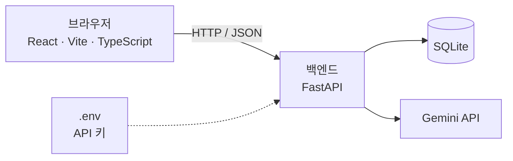

# API-SPEC: 에러 해결 일기 (v5)

## 1. 문서 설명
- 전체 구조, API 목록, 요청·응답 형식, 담당자를 담는 문서다. 기능 설명은 PRD에 있으므로 여기서는 R-ID로만 가리킨다.
- **이번 버전(v5)의 범위는 v4에 "시도 기록·해결 처리"(A-006 상세, A-005 `previous_attempts`)를 더한 것이다.**
  - 상세를 적는 API: A-001, A-003, A-004(`GET /series`, `GET /tags`), A-005, A-006
  - A-002는 호출 시점과 응답에 꼭 필요한 값만 적는다. 요청 필드 상세는 팀원 1이 작성한다.
  - 나머지 기능 API: 목록에 "후보"로 자리만 잡는다
- 이번 버전에서 다루지 않는 것:
  - 기능 API의 요청·응답 필드 (Q-001 ~ Q-004, DATA-MODEL 결정 후)
  - 테이블 구조 (DATA-MODEL_N.md)
  - Gemini 프롬프트와 응답 JSON 형식 (PROMPTS)
  - 배포 설정

## 2. 전체 구조



- 프론트는 백엔드 API만 호출한다. **프론트는 Gemini를 직접 호출하지 않는다.**
- Gemini API는 백엔드에서만 호출한다. API 키는 백엔드 `.env`에만 둔다. (CLAUDE.md 6절)
- 기술 스택: FastAPI + React(Vite, TypeScript) + SQLite + Gemini API (D-001)

## 3. 공통 규칙

**확정**
- 요청·응답 본문은 JSON을 쓴다.
- 로그인이 없으므로 인증 헤더를 쓰지 않는다. (D-002)
- 기본 경로(prefix)는 `/api`다. 모든 라우터에 붙인다.
- 성공 응답은 데이터를 그대로 반환한다. (감싸지 않음)
- 날짜·시간은 ISO 8601 한국 시간(`2026-11-02T15:00:00+09:00`)으로 응답한다. (D-015)

**[결정 필요]**

| 항목 | 선택지 | 장점 | 단점 |
|------|--------|------|------|
| 에러 응답 형식 | ① FastAPI 기본 `{ "detail": ... }` | 추가 코드가 필요 없다 | 입력 검증 에러(422)는 `detail`이 배열이라 모양이 다르다 |
| | ② `{ "error": { "code": ..., "message": ... } }` | 프론트에서 한 가지 방식으로 처리할 수 있다 | 예외 핸들러를 직접 만들어야 한다 |
| JSON 필드 이름 | ① snake_case (`created_at`) | 파이썬 코드를 그대로 쓴다 | TypeScript 관례와 다르다 |
| | ② camelCase (`createdAt`) | TypeScript 관례에 맞다 | FastAPI에 별칭(alias) 설정이 필요하다 |
| URL 이름 | ① 복수 명사 + kebab-case (`/errors`, `/ai-suggestions`) | 흔히 쓰는 방식이라 읽기 쉽다 | - |
| | ② 다른 규칙 | 팀이 정한 방식을 따른다 | 5절 후보 경로를 바꿔야 한다 |

## 4. 개발 환경 연결 방식

**확정**
- 프론트는 Vite 개발 서버 프록시로 백엔드를 호출한다. `/api`로 시작하는 요청을 백엔드로 전달한다. (`frontend/vite.config.ts`의 `server.proxy`)
- 그래서 백엔드에는 CORS 설정을 넣지 않는다.
- 백엔드 포트는 8000이다. (uvicorn 기본값)
- FastAPI 자동 문서는 `http://localhost:8000/docs`에서 직접 연다. (`/api` 밖이라 프록시를 거치지 않음)

**[결정 필요]**

| 항목 | 선택지 | 장점 | 단점 |
|------|--------|------|------|
| 프론트 포트 | ① Vite 기본값 5173 | 별도 설정이 필요 없다 | 다른 프로젝트와 같이 실행하면 충돌할 수 있다 |
| | ② 직접 지정 | 충돌을 피할 수 있다 | 두 사람이 같은 설정을 맞춰야 한다 |

- 실행 명령은 README에서 정한다. [결정 필요]

## 5. API 목록

경로는 prefix를 뺀 상대 경로다. **A-007 ~ A-009는 후보이며 확정이 아니다.**

| ID | 이름 | 메서드 | 경로 | 관련 R-ID | 담당 | 상태 |
|----|------|--------|------|-----------|------|------|
| A-001 | 연결 확인 | GET | `/health` (전체: `/api/health`) | - | 공용 | 구현됨 |
| A-002 | 에러 등록 | POST | `/errors` | R-001 | 팀원 1 | 구현됨 (6절) |
| A-003 | 기존 기록 검색 | POST | `/errors/search` (전체: `/api/errors/search`) | R-002 | 팀원 1 | 구현됨 (6절, D-035) |
| A-004 | 태그·시리즈 목록 | GET | `/tags`, `/series` (전체: `/api/tags`, `/api/series`) | R-001 (PRD 6절 규칙) | 팀원 1 | `/series`, `/tags` 구현됨 |
| A-005 | AI 해결책 제안 | POST | `/ai-suggestions` (전체: `/api/ai-suggestions`) | R-003 | 팀원 2 | 구현됨 (저장 없음, D-027, `previous_attempts` 포함) |
| A-006 | 시도 기록 | POST | `/errors/{id}/attempts` (전체: `/api/errors/{id}/attempts`) | R-004 | 팀원 2 | 구현됨 (6절) |
| A-007 | 한 줄 정리 수정 | PATCH 또는 POST | `/errors/{id}` 또는 `/errors/{id}/summary` | R-004 | 팀원 2 | 후보. 해결 처리는 A-006이 맡고 A-007은 한 줄 정리 수정만 (D-026) |
| A-008 | 내 기록 목록 | GET | `/errors` | R-005 | 팀원 1 | 후보 (Q-004 결정 후 작성) |
| A-009 | 에러 일기 상세 | GET | `/errors/{id}` | R-004, R-005 | 팀원 1 (D-031) | 후보 (S-003과 함께 작성). 응답에 시도 목록과 `summary` 포함 예정 |

- 기능 API의 요청·응답 필드는 해당 Q-ID와 DATA-MODEL이 결정된 뒤 작성한다.
- 시리즈를 따로 만드는 API(예: `POST /series`)는 두지 않는다. 새 시리즈는 에러 저장(A-002) 때 함께 만든다. (D-011)
- 태그도 따로 만드는 API(예: `POST /tags`)는 두지 않는다. 새 태그는 에러 저장(A-002) 때 함께 만든다. (D-020)
- 담당은 CLAUDE.md 5절을 따른다. A-009는 팀원 1이 맡는다. (D-031)
- A-006의 해결 처리는 팀원 1의 `repositories/errors.py`에 있는 `mark_resolved()`를 부른다. 이 함수는 팀원 2가 추가한다. (D-030)
- 라우터 파일은 경로가 아니라 담당 기준으로 나눈다. `/errors` 경로를 두 사람이 함께 쓰지만, 각자 자기 파일에만 추가한다.

| 담당 | 라우터 파일 | API |
|------|-------------|-----|
| 공용 | `backend/app/routers/health.py` | A-001 |
| 팀원 1 | `backend/app/routers/records.py` | A-002(구현됨), A-003(구현됨), A-004(`/series`, `/tags` 구현됨), A-008, A-009 |
| 팀원 2 | `backend/app/routers/solve.py` | A-005(구현됨), A-006(구현됨), A-007 |

- `main.py`는 `records`를 `solve`보다 먼저 등록한다. 고정 경로(`/errors/search`)가 변수 경로(`/errors/{id}`)보다 먼저 매칭되게 하기 위해서다.

## 6. API 상세

### A-001 연결 확인
| 항목 | 내용 |
|------|------|
| 목적 | 서버가 살아 있는지만 응답한다 |
| 메서드 | GET |
| 경로 | `/api/health` |
| 요청 | 본문 없음, 인증 헤더 없음 |
| 처리 | DB와 Gemini를 호출하지 않는다 |
| 담당 | 공용 (`backend/app/routers/health.py`) |

**응답 예시 (200)**
```json
{ "status": "ok" }
```

### A-002 에러 등록
| 항목 | 내용 |
|------|------|
| 목적 | 새 에러를 미해결(`unresolved`) 상태로 저장한다 (R-001, D-024) |
| 메서드·경로 | `POST /api/errors` |
| 호출 시점 | 새 에러로 확정되는 순간. "해당 없음 → AI에게 묻기"를 누를 때, 또는 비슷한 기록이 0건이라 바로 AI로 넘어갈 때. 프론트는 A-002가 성공한 뒤 A-005를 부른다 (D-025) |
| 처리 | 모든 검사를 먼저 하고, 통과하면 새 시리즈 → 새 태그 → 에러 → `error_tags` 순서로 한 트랜잭션에 저장한다. 검사에 실패하면 아무것도 저장되지 않는다 |
| 담당 | 팀원 1 (라우터 `backend/app/routers/records.py`, SQL `backend/app/repositories/errors.py`·`series.py`·`tags.py`) |

**요청 필드**
| 필드 | 타입 | 필수 | 설명 |
|------|------|------|------|
| `error_message` | 문자열 | 필수 | 에러 메시지. 앞뒤 공백을 빼고 저장한다. 비면 422. 최대 10,000자(A-005와 같은 상한, 넘으면 422) |
| `situation` | 문자열 / null | 선택 | 상황. 앞뒤 공백을 빼고, 비면 null로 저장한다 |
| `series_id` | 정수 / null | 선택 | 기존 시리즈 ID. 없는 ID면 422 |
| `new_series_name` | 문자열 / null | 선택 | 새 시리즈 이름. 기존 시리즈와 같으면(공백 제외·대소문자 무시) 기존 시리즈를 쓴다 (D-017, D-033). 공백뿐이면 422 |
| `tag_ids` | 정수 배열 | 선택 | 기존 태그 ID. 없는 ID가 있으면 422 |
| `new_tag_names` | 문자열 배열 | 선택 | 새 태그 이름. 정규화(D-019)한 뒤 빈 값은 버리고, 기존 태그와 같으면 기존 태그로 합친다 |

- `series_id`와 `new_series_name`은 둘 중 하나만 보낸다. 둘 다 보내면 422, 둘 다 없으면 시리즈 없음.
- 태그는 `tag_ids`와 `new_tag_names`를 합쳐 중복을 뺀 뒤 5개를 넘으면 422 (D-022).

**요청 예시**
```json
{
  "error_message": "ModuleNotFoundError: No module named 'google.generativeai'",
  "situation": "새로 만든 가상환경에서 처음 실행함",
  "series_id": null,
  "new_series_name": "개발 환경",
  "tag_ids": [1],
  "new_tag_names": ["가상환경"]
}
```

**응답 예시 (201)**
```json
{
  "id": 12,
  "error_message": "ModuleNotFoundError: No module named 'google.generativeai'",
  "situation": "새로 만든 가상환경에서 처음 실행함",
  "status": "unresolved",
  "series": { "id": 3, "name": "개발 환경" },
  "tags": [{ "id": 1, "name": "Python" }, { "id": 4, "name": "가상환경" }],
  "created_at": "2026-11-02T15:30:00+09:00"
}
```

- `id`는 이후 A-006 경로(`/api/errors/{id}/attempts`)에 쓴다.
- 422의 응답 본문은 FastAPI 기본 `{ "detail": ... }`이다(`detail`은 안내 문구 문자열, 필드 형식 오류면 배열). 형식 통일은 3절 [결정 필요].

### A-003 기존 기록 검색
| 항목 | 내용 |
|------|------|
| 목적 | 입력한 에러 메시지와 비슷한 해결된 기록을 유사도 높은 순으로 돌려준다 (R-002, D-035) |
| 메서드·경로 | `POST /api/errors/search` (에러 메시지가 최대 1만 자라 GET 쿼리 대신 본문으로 받는다) |
| 호출 시점 | "해결 방법 찾기"를 누를 때. 에러를 저장하기 전이며, 이 API는 아무것도 저장하거나 바꾸지 않는다 (D-025) |
| 요청 | JSON 본문 `error_message` (문자열, 최대 10,000자). 공백뿐이면 422, 넘으면 422. 인증 헤더 없음 |
| 처리 | `resolved` 상태인 기록만 비교한다. 두 메시지의 공백 모양과 대소문자를 무시하고 `difflib.SequenceMatcher`의 비율을 0~100%(반올림)로 바꾼다. 60% 이상만 돌려준다 |
| 정렬 | 유사도 내림차순. 같으면 `id`가 큰(최근) 기록이 먼저. 개수 제한은 없다 (화면에서 위 2건만 보이고 나머지는 스크롤, SCREEN-SPEC_4) |
| 담당 | 팀원 1 (라우터 `backend/app/routers/records.py`, SQL `backend/app/repositories/errors.py`·`tags.py`. 시도 수 집계는 `repositories/attempts.py`의 `count_by_error_ids()`를 팀원 1이 추가) |

**요청 예시**
```json
{ "error_message": "ModuleNotFoundError: No module named 'google.generativeai'" }
```

**응답 예시 (200)**
```json
[
  {
    "id": 3,
    "error_message": "ModuleNotFoundError: No module named 'google.generativeai'",
    "similarity": 100,
    "summary": "패키지가 다른 가상환경에 설치돼 있었음. which python으로 환경 확인 후 프로젝트 환경 활성화",
    "attempt_count": 2,
    "tags": [{ "id": 1, "name": "Python" }, { "id": 4, "name": "가상환경" }],
    "resolved_at": "2026-11-02T15:40:00+09:00"
  }
]
```

**응답 필드** (배열의 각 항목)
| 필드 | 타입 | 설명 |
|------|------|------|
| `id` | 정수 | 비슷한 기록의 에러 ID |
| `error_message` | 문자열 | 그 기록의 에러 메시지 (화면은 첫 줄만 제목으로 쓴다) |
| `similarity` | 정수 | 유사도(%), 60~100 |
| `summary` | 문자열 | 내 한 줄 정리 = 해결법 |
| `attempt_count` | 정수 | 그 기록의 시도 수 ("시도 N회 만에 해결") |
| `tags` | 배열 | 붙은 태그 (`id`, `name`, id순) |
| `resolved_at` | 문자열 | 해결 시각. ISO 8601 한국 시간 (D-015) |

- 비슷한 기록이 없으면 빈 배열 `[]`을 돌려준다. 프론트는 0건이면 바로 A-002 → A-005로 넘어간다 (SCREEN-SPEC_4 화면 흐름).
- 유사도는 글자 단위 비교라서, 앞부분이 같은 메시지(예: `ModuleNotFoundError: No module named …`)끼리는 뒷부분이 달라도 60%를 넘을 수 있다. Traceback 전체와 한 줄 메시지처럼 길이가 크게 다를 때의 보정은 Later (PRD Q-002).
- "같은 에러예요, 이 방법 적용"은 전용 API 없이 A-002 → A-006(`result=solved`, `summary`는 고른 기록의 `summary`)로 처리한다 (D-036).
- 422의 응답 본문은 A-002와 같다.

### A-004 시리즈 목록 (`GET /series`)
| 항목 | 내용 |
|------|------|
| 목적 | 에러 해결 화면에서 고를 수 있는 기존 시리즈 목록을 돌려준다 (R-001, D-006) |
| 메서드 | GET |
| 경로 | `/api/series` |
| 요청 | 본문·쿼리 없음, 인증 헤더 없음 |
| 처리 | `series` 테이블 전체를 `created_at` 내림차순(최근 만든 순)으로 돌려준다. `created_at`이 같으면 `id`가 큰 것이 먼저다. 테이블 구조는 DATA-MODEL_N.md |
| 담당 | 팀원 1 (라우터 `backend/app/routers/records.py`, SQL `backend/app/repositories/series.py`, D-016) |

**응답 예시 (200)**
```json
[
  { "id": 2, "name": "Gemini API 연동", "description": "Gemini 호출하며 만난 에러", "created_at": "2026-11-02T15:30:00+09:00" },
  { "id": 1, "name": "개발 환경", "description": null, "created_at": "2026-11-01T10:00:00+09:00" }
]
```

**응답 필드** (배열의 각 항목)
| 필드 | 타입 | 설명 |
|------|------|------|
| `id` | 정수 | 시리즈 ID |
| `name` | 문자열 | 시리즈 이름 (중복 없음) |
| `description` | 문자열 / null | 시리즈 설명. 없으면 null |
| `created_at` | 문자열 | 만든 시각. ISO 8601 한국 시간 (D-015) |

- 시리즈가 하나도 없으면 빈 배열 `[]`을 돌려준다.
- 성공 응답은 감싸지 않은 배열이다 (3절). 필드 이름은 A-005와 같이 snake_case를 쓴다 (3절 [결정 필요]는 그대로).
- DB 오류 시 응답 형식은 3절 "에러 응답 형식" [결정 필요]를 따른다.

### A-004 태그 목록 (`GET /tags`)
| 항목 | 내용 |
|------|------|
| 목적 | 에러 해결 화면의 태그 자동 완성에 쓸 기존 태그 전체 목록을 돌려준다 (R-001, D-006, D-021) |
| 메서드 | GET |
| 경로 | `/api/tags` |
| 요청 | 본문·쿼리 없음, 인증 헤더 없음. 검색어로 거르지 않고 전체를 준다 (거르는 것은 프론트, D-021) |
| 처리 | `tags` 테이블 전체를 `name_key` 오름차순(이름순, 대소문자 무시)으로 돌려준다. `name_key`가 같을 수는 없지만 정렬을 고정하려고 `id` 오름차순을 덧붙인다. 테이블 구조는 DATA-MODEL_N.md |
| 담당 | 팀원 1 (라우터 `backend/app/routers/records.py`, SQL `backend/app/repositories/tags.py`, D-016) |

**응답 예시 (200)**
```json
[
  { "id": 2, "name": "AI", "created_at": "2026-11-02T15:30:00+09:00" },
  { "id": 1, "name": "Python", "created_at": "2026-11-01T10:00:00+09:00" },
  { "id": 3, "name": "가상환경", "created_at": "2026-11-02T16:00:00+09:00" }
]
```

**응답 필드** (배열의 각 항목)
| 필드 | 타입 | 설명 |
|------|------|------|
| `id` | 정수 | 태그 ID |
| `name` | 문자열 | 보이는 이름. 처음 입력한 표기 그대로 (D-019) |
| `created_at` | 문자열 | 만든 시각. ISO 8601 한국 시간 (D-015) |

- 비교용 `name_key`는 응답에 넣지 않는다. 프론트는 같은 규칙(DATA-MODEL tags 정규화 규칙)으로 직접 비교한다.
- 태그가 하나도 없으면 빈 배열 `[]`을 돌려준다.
- 정렬은 에러가 저장되기 시작하면 "많이 쓴 순"으로 바꾼다 (D-021, 그때 새 D-ID).
- 성공 응답·필드 이름·DB 오류 처리는 `GET /series`와 같다.

### A-005 AI 해결책 제안
| 항목 | 내용 |
|------|------|
| 목적 | 입력한 에러 메시지를 Gemini가 분석해 추정 원인과 해결 제안을 돌려준다 (R-003) |
| 메서드 | POST |
| 경로 | `/api/ai-suggestions` |
| 요청 | JSON 본문 `error_message` (문자열, 1~10,000자), `previous_attempts` (선택, 아래 참고). 인증 헤더 없음 |
| 호출 시점 | ① 새 에러를 A-002로 저장한 직후 (D-025) ② "해결 안 됨 → 다음 방법 제안받기"에서 실패 시도를 A-006으로 저장한 직후, 지금까지의 시도를 `previous_attempts`로 붙여서 (D-027) |
| 처리 | Gemini를 백엔드에서만 호출한다. AI 제안은 DB에 저장하지 않는다 (D-027) |
| 실패 처리 | 아래 "실패 시" 참고. Gemini 쪽 문제로는 에러 응답을 내지 않고 항상 200 |
| 담당 | 팀원 2 (`backend/app/routers/solve.py`) |

**요청 예시**
```json
{ "error_message": "ModuleNotFoundError: No module named 'google.generativeai'" }
```

**요청 예시 (다음 방법 제안, `previous_attempts` 포함)**
```json
{
  "error_message": "ModuleNotFoundError: No module named 'google.generativeai'",
  "previous_attempts": [
    { "action": "pip install google-generativeai 재설치", "result": "failed" },
    { "action": "가상환경 다시 활성화", "result": "partial" }
  ]
}
```

**`previous_attempts` 필드** (선택, D-027)
| 필드 | 타입 | 설명 |
|------|------|------|
| `action` | 문자열 | 시도한 내용 |
| `result` | `"failed"` / `"partial"` | 결과 (D-028). 해결된 에러에는 다음 방법을 묻지 않으므로 `solved`는 오지 않는다 |

- 없거나 빈 배열이면 지금과 똑같이 동작한다 (하위 호환).
- 있으면 프롬프트에 "이미 실패한 방법은 다시 제안하지 않는다"를 더하고, 시도 내용은 `<error>`처럼 데이터로만 다룬다(그 안의 지시문은 따르지 않음). 프롬프트는 PROMPTS_2 P-001 v2에 기록했다.
- 항목의 `action`이 비었거나 `result`가 `failed`·`partial`이 아니면 422.
- 실패 처리(재시도, 대체 모델, unavailable 안내)는 아래 "실패 시"와 같다.

**응답 예시 (200, 성공)**
```json
{
  "status": "ok",
  "confidence": "높음",
  "cause": "패키지가 현재 파이썬 환경에 설치되어 있지 않다",
  "solutions": ["pip install google-generativeai 실행", "가상환경이 활성화됐는지 확인"],
  "message": null
}
```

**응답 필드**
| 필드 | 타입 | 설명 |
|------|------|------|
| `status` | `"ok"` 또는 `"unavailable"` | 분석 성공 여부 |
| `confidence` | `"높음"` / `"보통"` / `"낮음"` / null | 확신도. unavailable이면 null |
| `cause` | 문자열 / null | 추정 원인 |
| `solutions` | 문자열 배열 | 해결 제안(순서대로). unavailable이면 빈 배열 |
| `message` | 문자열 / null | unavailable일 때 화면에 보여줄 안내 문구 |

**실패 시**
- Gemini 시간 초과·실패 응답·JSON 형식 오류: `gemini-3.5-flash`를 최대 3회 → `gemini-3.5-flash-lite`를 최대 2회 시도한다. 모두 실패하면 200으로 `{ "status": "unavailable", "confidence": null, "cause": null, "solutions": [], "message": "지금은 AI 분석을 가져오지 못했어요. 잠시 뒤 다시 시도해 주세요." }`를 돌려준다.
- `GEMINI_API_KEY`가 비어 있어도 같은 unavailable 응답을 돌려준다.
- `error_message`가 비었거나 10,000자를 넘으면 422 (FastAPI 기본 검증 응답).
- 프론트는 네트워크 오류가 나도 같은 안내를 보여준다.

### A-006 시도 기록
| 항목 | 내용 |
|------|------|
| 목적 | 에러에 시도 하나를 저장한다. 결과가 "해결됨"이면 한 줄 정리와 해결 처리까지 함께 한다 (R-004, D-026) |
| 메서드 | POST |
| 경로 | `/api/errors/{id}/attempts` (`{id}`는 A-002가 돌려준 에러 ID, D-025) |
| 요청 | JSON 본문 `action`, `result`, `summary`(아래 표). 인증 헤더 없음 |
| 처리 | 아래 "처리 순서" |
| 담당 | 팀원 2 (라우터 `backend/app/routers/solve.py`, SQL `backend/app/repositories/attempts.py` + `repositories/errors.py`의 `mark_resolved()`, D-030) |

**요청 필드**
| 필드 | 타입 | 필수 | 설명 |
|------|------|------|------|
| `action` | 문자열 | 필수 | "무엇을 했나요". 앞뒤 공백을 뺀 값이 비면 422 |
| `result` | `"solved"` / `"failed"` / `"partial"` | 필수 | 결과 (D-028). 다른 값이면 422 |
| `summary` | 문자열 / null | `solved`일 때 필수 | 내 한 줄 정리. `solved`인데 비어 있으면 422. `solved`가 아니면 무시한다 |

**요청 예시 (해결됨)**
```json
{
  "action": "response_mime_type 설정 추가하고 다시 실행",
  "result": "solved",
  "summary": "AI가 JSON을 꾸며서 보내서 파싱이 안 됐고, 응답 형식을 설정으로 고정해서 해결했다"
}
```

**처리 순서** (한 트랜잭션)
1. 에러가 없으면 404.
2. 에러가 이미 `resolved`이면 409. 해결된 에러에는 시도를 추가하지 않는다 (D-032).
3. `seq` = 그 에러의 마지막 시도 번호 + 1 (첫 시도는 1). `(error_id, seq)` UNIQUE라 동시에 두 번 저장돼도 같은 번호가 생기지 않는다. 이때 늦은 쪽은 409 "같은 시도가 동시에 저장됐어요" (DATA-MODEL attempts).
4. 시도를 저장한다.
5. `result=solved`이면 같은 트랜잭션에서 에러의 `status=resolved`, `summary`, `resolved_at`을 바꾼다 (D-026, `mark_resolved()`).
6. `failed`·`partial`이면 에러는 `unresolved` 그대로 둔다 (D-029).

**응답 예시 (201)**
```json
{
  "attempt": { "id": 7, "error_id": 12, "seq": 1, "action": "response_mime_type 설정 추가하고 다시 실행", "result": "solved", "created_at": "2026-11-02T15:40:00+09:00" },
  "error": { "id": 12, "status": "resolved", "summary": "AI가 JSON을 꾸며서 보내서 파싱이 안 됐고, 응답 형식을 설정으로 고정해서 해결했다", "resolved_at": "2026-11-02T15:40:00+09:00" }
}
```

- `failed`·`partial`이면 `error.status`는 `unresolved`, `summary`·`resolved_at`은 null이다.
- 404·409·422의 응답 본문 형식은 3절 "에러 응답 형식" [결정 필요]를 따른다.
- 프론트는 "해결 안 됨 → 다음 방법 제안받기"에서 A-006이 성공한 뒤 A-005를 `previous_attempts`와 함께 부른다 (D-027). A-005가 실패해도 시도는 이미 저장된 상태다.

## 7. 완료 기준
- [ ] 두 사람 컴퓨터에서 백엔드와 프론트가 각각 실행된다 (실행 명령은 README, [결정 필요])
- [x] 브라우저에서 A-001을 직접 호출하면 응답 예시와 같은 응답이 온다 (2026-10-30 백엔드 확인)
- [ ] 프론트에서 A-001을 호출해 응답을 받는다
- [x] 프론트에서 A-005를 호출해 AI 분석 결과를 받는다 (2026-11-02, 에러 해결 화면 "AI 분석" 탭)
- [x] `GET /api/series`가 응답 예시와 같은 형식으로 최근 만든 순 목록을 돌려준다 (2026-11-02 백엔드 확인, 빈 목록 `[]` 포함)
- [x] `GET /api/tags`가 응답 예시와 같은 형식으로 이름순 목록을 돌려주고, 같은 `name_key`는 DB에서 막힌다 (2026-11-02 백엔드 확인, 빈 목록 `[]` 포함)
- [x] A-002가 에러를 미해결로 저장하고, 새 시리즈·태그를 합치거나 만들며, 검사 실패 시 아무것도 남기지 않는다 (2026-11-02 백엔드 확인)
- [x] A-006이 시도 번호를 1, 2, 3… 순서로 매기고, `solved`면 해결 처리까지 하며, 404·409·422 규칙대로 응답한다 (2026-11-02 백엔드 확인)
- [x] A-005가 `previous_attempts` 없이도 그대로 동작하고, 있으면 프롬프트에 `<attempts>` 블록이 붙는다 (2026-11-02 백엔드 확인, 실제 Gemini 응답은 미확인)
- [x] A-003이 해결된 기록만 유사도 60% 이상, 높은 순으로 돌려주고, 미해결 기록·무관한 메시지·빈 입력(422)을 응답 예시대로 처리한다 (2026-11-02 임시 DB 백엔드 확인)
- [ ] 프론트 코드에 Gemini API 키와 Gemini 직접 호출이 없다
- [x] 백엔드에 `.env.example`이 있고, `.env`는 `.gitignore`로 커밋에서 제외된다

## 8. 변경 이력

| 버전 | 날짜 | 내용 |
|------|------|------|
| v1 | 2026-10-30 | 뼈대 범위 최초 작성 (전체 구조, 공통 규칙, 연결 방식, A-001 상세, 기능 API 후보 목록) |
| v1 | 2026-10-30 | 백엔드 뼈대 구현 반영: prefix `/api`, 성공 응답 감싸지 않음, Vite 프록시·CORS 없음, 백엔드 포트 8000, A-001 `/api/health` 구현됨, 라우터 파일 담당 |
| v1 | 2026-11-02 | Vite 프록시 설정 추가(`/api` → `http://localhost:8000`). Vite 개발 서버 경유 `/api/health` 응답 확인. 프론트 코드에서의 호출은 아직 없음(7절 미완료 유지) |
| v2 | 2026-11-02 | A-005 구현·확정: 경로를 `/api/ai-suggestions`로 정함(저장 없는 버전이라 `{id}` 없음), 요청·응답 형식, 실패 시 재시도·대체 모델·안내 응답 추가. 필드 이름은 snake_case로 사용 중(3절 [결정 필요]는 그대로) |
| v3 | 2026-11-02 | A-004 중 `GET /api/series` 상세 작성(최근 만든 순, 빈 목록 `[]`, 미구현). 시리즈 추가 API는 두지 않음(D-011). `/tags`는 후보 유지 |
| v3 | 2026-11-02 | 3절 날짜 형식을 한국 시간 ISO로 확정(D-015). A-004 응답 예시·필드 설명 갱신(description null 허용) |
| v3 | 2026-11-02 | A-004 `GET /api/series` 구현됨(SQL은 `repositories/series.py`, D-016). 같은 시각이면 id 내림차순 |
| v4 | 2026-11-02 | A-004 `GET /api/tags` 상세 작성(전체 목록, 이름순, 빈 목록 `[]`, `name_key`는 응답에 없음, 미구현). 태그 추가 API는 두지 않음(D-020) |
| v4 | 2026-11-02 | A-004 `GET /api/tags` 구현됨(SQL은 `repositories/tags.py`, D-016). 7절 확인 항목 추가 |
| v5 | 2026-11-02 | A-002 호출 시점·응답 필수 값(D-025), A-005 호출 시점과 `previous_attempts`(D-027), A-006 상세(요청·처리 순서·404/409/422·응답, D-026, D-028 ~ D-030, D-032), A-007 역할을 "한 줄 정리 수정"으로 변경(D-026), A-009 담당 팀원 1(D-031). 모두 미구현 |
| v5 | 2026-11-02 | A-003 구현됨: `POST /api/errors/search`, 요청·응답 필드, 해결된 기록만·유사도 60% 이상·높은 순(D-035), "이 방법 적용"은 A-002 → A-006(D-036). 7절 확인 항목 추가 |
| v5 | 2026-11-02 | A-002 구현됨: 요청 필드(평평한 필드 `series_id`/`new_series_name`, `tag_ids`/`new_tag_names`), 검사 후 한 트랜잭션 저장, 같은 이름 시리즈는 기존 사용(D-033), 응답 예시. A-005 `previous_attempts`·A-006 구현됨. 7절 확인 항목 추가 |
